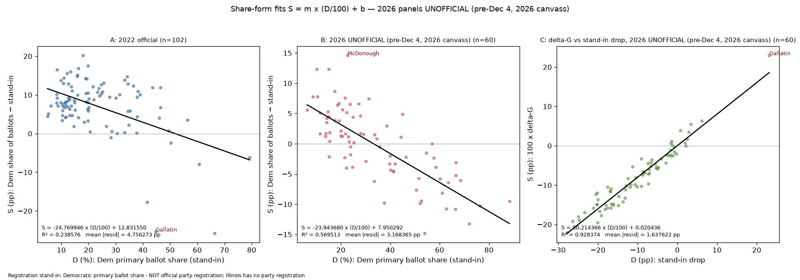
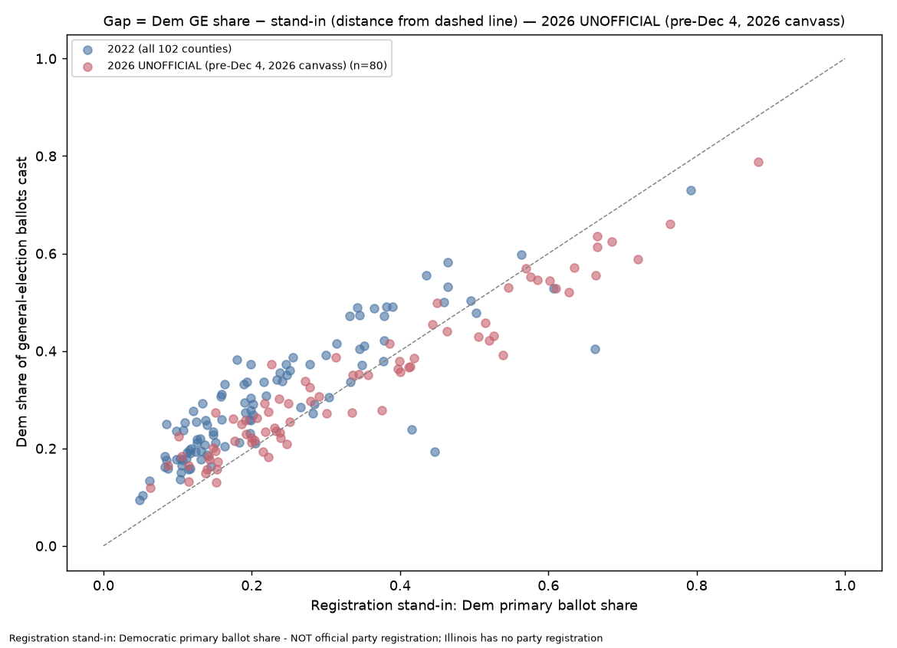

# Graphs

> **\*2026 figures are UNOFFICIAL (pre-Dec 4, 2026 canvass), not certified by the Illinois State Board of Elections.** Governor race unless a page says otherwise. Votes are votes for the Democratic candidate. **Registration stand-in: Democratic primary ballot share - NOT official party registration; Illinois has no party registration:** R and D on these pages are Democratic primary ballots ÷ all primary ballots × 100 (SBOE official primary canvass), not a count of registered Democrats. These pages measure a pattern; they make no claim about intent, fraud or cause.

## 1. Share-form fits S = m x (D/100) + b (A 2022 official; B, C 2026)

*Panel A is the locked Surplus Equation (2022, n = 102): S = -24.769946 × (D/100) + 12.831550. Panels B and C are secondary 2026\* fits. 2026 = UNOFFICIAL (pre-Dec 4, 2026 canvass). Registration stand-in: Democratic primary ballot share - NOT official party registration; Illinois has no party registration.*

## 2. Stand-in vs Dem share (gap)

*Vertical distance from the dashed line = G (the surplus S on the locked equation), 2022 in blue, 2026\* in red. 2026 = UNOFFICIAL (pre-Dec 4, 2026 canvass). Registration stand-in: Democratic primary ballot share - NOT official party registration; Illinois has no party registration.*

## 3. Share change vs stand-in drop with the fitted line

*Each dot is one county (n = 80). Line: the original change-vs-drop fit. Vertical distance from the line = residual. 2026 = UNOFFICIAL (pre-Dec 4, 2026 canvass). Registration stand-in: Democratic primary ballot share - NOT official party registration; Illinois has no party registration.*

## 4. Dem share of ballots cast, 2022 vs 2026

*Each dot is one county; dashed line = no change. Floor and ceiling counties labeled. 2026 = UNOFFICIAL (pre-Dec 4, 2026 canvass). Registration stand-in: Democratic primary ballot share - NOT official party registration; Illinois has no party registration.*

## 5. Implied extra votes by county

*Residual × 2026 ballots cast, by county (symlog scale). Hypothesis label applies (see Bottom-Up Reverse Math). 2026 = UNOFFICIAL (pre-Dec 4, 2026 canvass). Registration stand-in: Democratic primary ballot share - NOT official party registration; Illinois has no party registration.*

---
**Related:** [Bottom-Up Reverse Math](Reverse-Math) · [Locked Illinois Formula](Locked-Illinois-Formula) · [Floor and Ceiling Counties](Floor-and-Ceiling) · [Home](Home) · [Cedar County Audit (Nebraska)](https://github.com/mbenson8989/Nebraska-Election-Analysis-/wiki/Cedar-Audit) · [PDF report](https://github.com/mbenson8989/Illinois-Election-Analysis/blob/main/report/Illinois_Reverse_Factoring_Report_UNOFFICIAL_2026.pdf)

Registration stand-in: Democratic primary ballot share - NOT official party registration; Illinois has no party registration. 2026 = UNOFFICIAL (pre-Dec 4, 2026 canvass). Built Sunday, November 22, 2026, 11:59 PM CST (2026 county data refreshed Nov 22).
