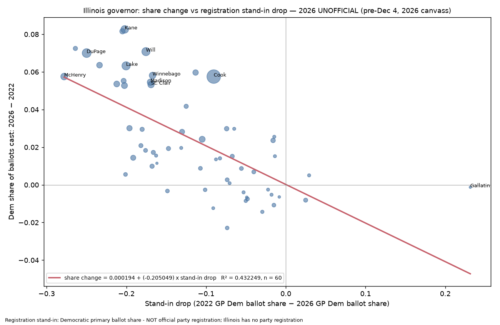
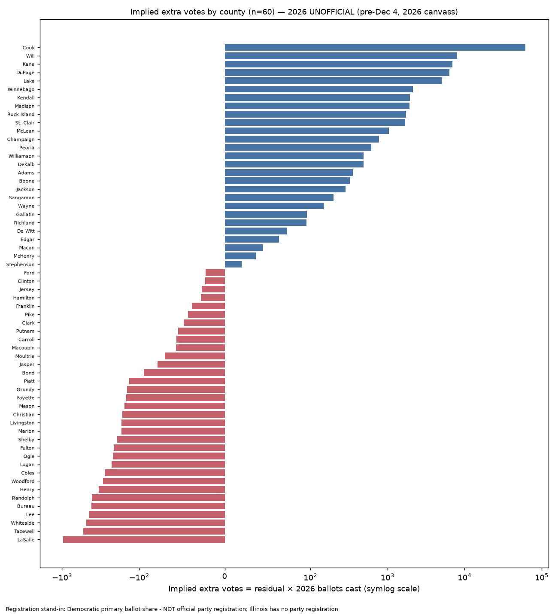
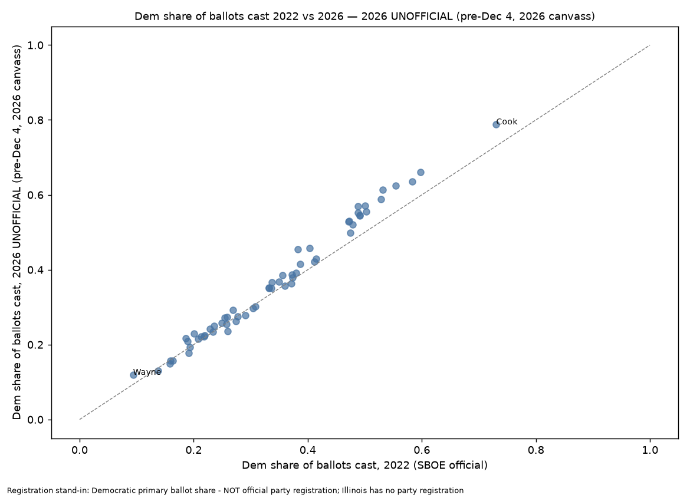

# Graphs
> **2026 figures are UNOFFICIAL (pre-Dec 4, 2026 canvass).** 2022 figures are SBOE official canvass.
>
> **Registration stand-in: Democratic primary ballot share - NOT official party registration; Illinois has no party registration.**

## Share change vs stand-in drop with the fitted line — 2026 UNOFFICIAL (pre-Dec 4, 2026 canvass)

## Implied extra votes by county — 2026 UNOFFICIAL (pre-Dec 4, 2026 canvass)

## Dem share of ballots cast, 2022 vs 2026 — 2026 UNOFFICIAL (pre-Dec 4, 2026 canvass)

## Stand-in vs Dem share (gap) — 2026 UNOFFICIAL (pre-Dec 4, 2026 canvass)

---
Registration stand-in: Democratic primary ballot share - NOT official party registration; Illinois has no party registration. 2026 = UNOFFICIAL (pre-Dec 4, 2026 canvass). Cross-link: [Cedar Audit (Nebraska)](https://github.com/mbenson8989/Nebraska-Election-Analysis-/wiki/Cedar-Audit) · [PDF report](https://github.com/mbenson8989/Illinois-Election-Analysis/blob/main/report/Illinois_Reverse_Factoring_Report_UNOFFICIAL_2026.pdf) · Built Thursday, November 19, 2026 (CST).
