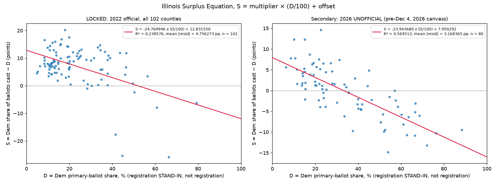

# Locked Illinois Formula

> **\*2026 figures are UNOFFICIAL (pre-Dec 4, 2026 canvass), not certified by the Illinois State Board of Elections.** Governor race unless a page says otherwise. Votes are votes for the Democratic candidate. **Registration stand-in: Democratic primary ballot share - NOT official party registration; Illinois has no party registration:** R and D on these pages are Democratic primary ballots ÷ all primary ballots × 100 (SBOE official primary canvass), not a count of registered Democrats. These pages measure a pattern; they make no claim about intent, fraud or cause.

## The equation

- **Dem share** = Democratic governor votes ÷ total ballots cast × 100
- **D** (registration-share **STAND-IN**) = Democratic primary ballots ÷ all primary ballots × 100, from the SBOE official primary canvass (2022 General Primary, June 28, 2022; 2026 General Primary, March 17, 2026). *Registration stand-in: Democratic primary ballot share - NOT official party registration; Illinois has no party registration.*
- **S** (surplus) = Dem share − D, in percentage points

Illinois has no party registration, so D is a stand-in, never official registration. Illinois uses total ballots cast as the denominator.

## Illinois's equation in final form

### Surplus Equation (Illinois statewide constant)

**Surplus Equation: S = -24.769946 × (D/100) + 12.831550**

Where:
- S = Surplus, expressed in percentage points: the county's Democratic share of ballots cast minus D (2022, SBOE official canvass)
- D = Democratic registration-share **STAND-IN**, as a percent (0–100 scale): Democratic primary ballots ÷ all primary ballots × 100 (2022 General Primary). This is **not** party registration and not a headcount of registered Democrats.
- -24.769946 = Multiplier coefficient
- 12.831550 = Constant offset, in percentage points

Illinois's multiplier and offset come from an ordinary least-squares fit of S on D/100 across **all 102 counties**, 2022 official SBOE data: **R² = 0.238576**, **mean absolute residual 4.756273 points**, largest residual Gallatin (-27.073738). It was verified in two independent passes. 2022 is the locked year because it is the only year with official results for all 102 counties.

### County-level surplus

**S = Dem share − D**, and the county's **residual = S − [-24.769946 × (D/100) + 12.831550]**

Cook County plugged in (2022):

**S = 73.041222 − 79.245488 = -6.204266**; fitted = -6.797515; residual = **0.593249** points.

### Secondary fit (not the locked equation)

Same surplus form, S = m × (D/100) + b. 2026 is UNOFFICIAL (pre-Dec 4, 2026 canvass) and covers only the 80 counties with a county-authority ballots-cast figure. No gaps were filled.

| Fit | n | Multiplier | Offset | R² | Mean abs residual (pp) | Largest residual |
|---|---|---|---|---|---|---|
| **Locked: 2022 official** | 102 | -24.769946 | 12.831550 | 0.238576 | 4.756273 | Gallatin (-27.073738) |
| 2026 surplus, UNOFFICIAL (pre-Dec 4, 2026 canvass) | 80 | -23.943680 | 7.950292 | 0.569513 | 3.168365 | McDonough (12.104883) |

Every county's S, D, fitted value and residual (both years) is in [`out/surplus_pass_a.csv`](https://github.com/mbenson8989/Illinois-Election-Analysis/blob/main/out/surplus_pass_a.csv).

## Blank template

| Line | Item | 2022 | 2026* |
|---|---|---|---|
| 1 | Democratic governor votes | ______ | ______ |
| 2 | Total ballots cast | ______ | ______ |
| 3 | Dem share = line 1 ÷ line 2 × 100 | ______ | ______ |
| 4 | Democratic primary ballots (stand-in; SBOE primary canvass) | ______ | ______ |
| 5 | All primary ballots (SBOE primary canvass) | ______ | ______ |
| 6 | D = line 4 ÷ line 5 × 100 (stand-in, NOT registration) | ______ | ______ |
| 7 | S = line 3 − line 6 | ______ | ______ |
| 8 | D ÷ 100 | ______ | ______ |
| 9 | Multiplier × line 8 | ______ | ______ |
| 10 | Expected S = line 9 + offset | ______ | ______ |
| 11 | Residual = line 7 − line 10 | ______ | ______ |
| 12 | Residual in votes = line 11 ÷ 100 × line 2 | ______ | ______ |

## Rules for using this formula

1. **Use the locked multiplier and offset above for every Illinois county.** Do not refit per county.
2. **The starting point is different in every state. Don't assume Nebraska's numbers carry over.** Illinois's D is primary-ballot share, not registration. Its 2022→2026 statewide jump (51.88% → 67.87%) reflects which primaries were contested. Compare Illinois counties only against Illinois's own range.
3. **Always pull out the floor and ceiling counties.** See [Floor and Ceiling Counties](Floor-and-Ceiling).

## Worked example: Cook

| Line | Item | 2022 | 2026* |
|---|---|---|---|
| 1 | Democratic governor votes | 1,065,445 | 1,244,743* |
| 2 | Total ballots cast | 1,458,690 | 1,579,770* |
| 4 | Democratic primary ballots (stand-in) | 524,388 | 722,905 |
| 5 | All primary ballots | 661,726 | 818,820 |
| 6 | D (stand-in) | 79.245488 | 88.286192 |
| 7 | S | -6.204266 | -9.493520* |
| 10 | Expected S (locked line for 2022; 2026 line for 2026*) | -6.797515 | -13.188671* |
| 11 | Residual | 0.593249 | 3.695151* |

Cook 2026\* = Chicago Board of Election Commissioners + Cook County Clerk (suburban Cook).

### Registration stand-in evaluation (Morissa's rule: best available comparable number, not the easiest)
Illinois has **no party registration** (SBOE registration file lists only active/inactive voters per authority). Three candidates were evaluated:

| Option | Coverage | Accuracy as a party-strength measure | Defensibility / citability | Verdict |
|---|---|---|---|---|
| 1. SBOE Democratic primary ballot share (Dem ballots ÷ all primary ballots, per county) | All 102 counties, both 2022 and 2026, one uniform official source | Moderate: measures who *chose a Democratic ballot* in that primary; sensitive to which primaries were contested | Highest: SBOE official canvass PDFs (`2022GPOfficialVote.pdf`, `2026GPOfficialVote.pdf`), reproducible by anyone | **CHOSEN** |
| 2. Party of last primary voted, from county voter files | Not statewide: only some of Illinois' 108 election authorities publish D/R/NPP counts (e.g. Kane); others publish nothing or charge for files | Similar signal to option 1 (it is derived from the same primary choices), but mixed vintages and definitions | Low: inconsistent across counties; cannot cover 102 counties uniformly | Rejected |
| 3. Paid modeled party (L2 / Catalist) | Statewide | Modeled estimate, not a recorded act; method proprietary | Low for a public audit: paid, not reproducible, not citable; **not purchased** | Rejected |

**Caveat — 2022→2026 contest-structure jump.** Statewide the Democratic share of primary ballots went from **51.88%** (911,919 of 1,757,872, June 28, 2022) to **67.87%** (1,283,256 of 1,890,699, March 17, 2026). A 16-point move in one cycle reflects *which primaries were contested* (2022: competitive Republican governor primary; 2026: high-profile Democratic primaries), not a real shift in party loyalty. The stand-in **drop** is therefore negative in most counties, and the fitted multiplier measures how general-election share moved relative to that contest-driven swing. Read results as relative (county vs county), not as registration-based absolutes. Small-county primaries can swing on a single local contest (e.g. Gallatin, a high-leverage point on the fit chart).

## Verification

Every computed cell was produced by two independent passes (Pass A: exact fractions; Pass B: pandas/numpy). Each pass read the raw files separately, and the cells were compared to the decimal.

| Check | Cells compared | Matched | Mismatched |
|---|---|---|---|
| 2022 SBOE vote file, Pass A vs Pass B | 1,122 | 1,122 | 0 |
| 2022 vs SBOE PDF governor table | 204 | 204 | 0 |
| Stand-in (2022 & 2026 primary ballots), Pass A vs Pass B | 918 | 918 | 0 |
| 2026 county raw D/R/ballots (UNOFFICIAL (pre-Dec 4, 2026 canvass)), Pass A vs Pass B | 400 | 400 | 0 |
| Full computed table (102 counties × 20 cols), Pass A vs Pass B | 2,040 | 2,040 | 0 |
| Statewide summary (constant, multiplier, R², totals, floor/ceiling, flags) | 15 | 15 | 0 |
| Share-form fits (S = m × (D/100) + b), Pass A vs Pass B | 1,872 | 1,872 | 0 |
| Locked surplus equation (S, D, fitted, residual for 102 counties; fit statistics), Pass A vs Pass B | 1,136 | 1,136 | 0 |

---
**Related:** [Bottom-Up Reverse Math](Reverse-Math) · [Floor and Ceiling Counties](Floor-and-Ceiling) · [Graphs](Graphs) · [Home](Home) · [Cedar County Audit (Nebraska)](https://github.com/mbenson8989/Nebraska-Election-Analysis-/wiki/Cedar-Audit) · [PDF report](https://github.com/mbenson8989/Illinois-Election-Analysis/blob/main/report/Illinois_Reverse_Factoring_Report_UNOFFICIAL_2026.pdf)

Registration stand-in: Democratic primary ballot share - NOT official party registration; Illinois has no party registration. 2026 = UNOFFICIAL (pre-Dec 4, 2026 canvass). Built Sunday, November 22, 2026, 11:59 PM CST (2026 county data refreshed Nov 22).
