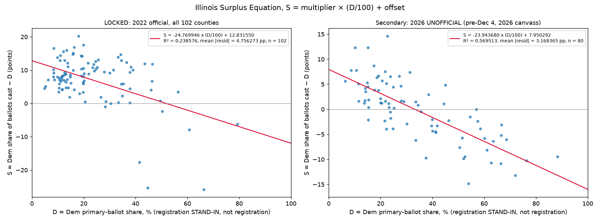
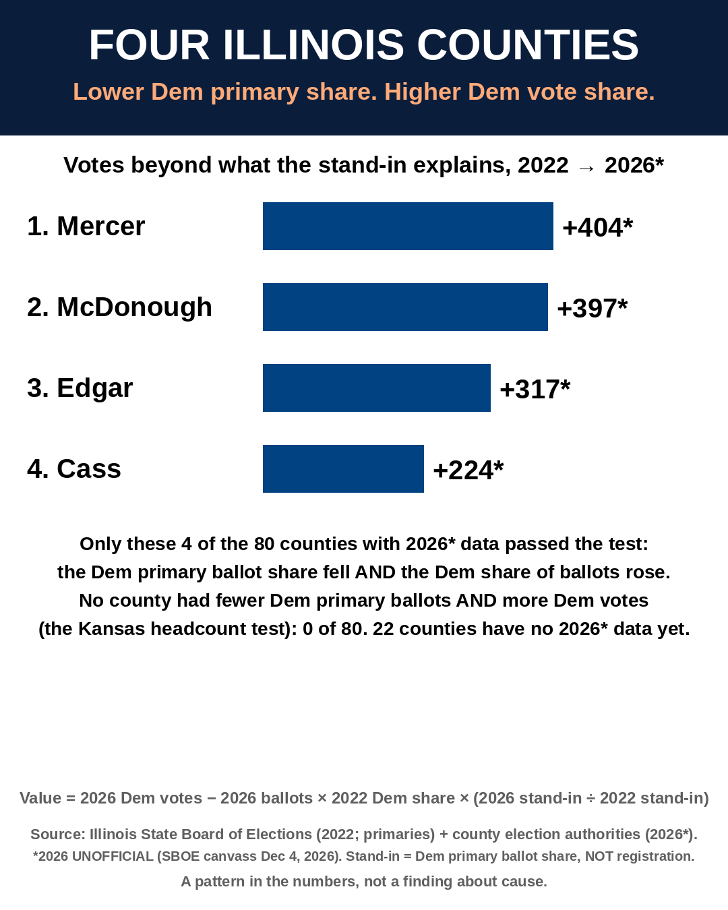
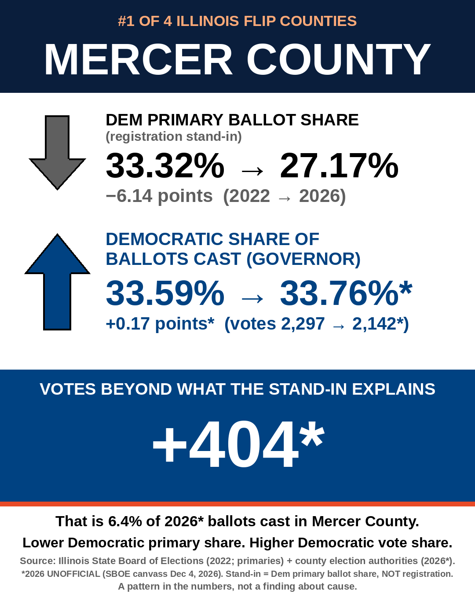
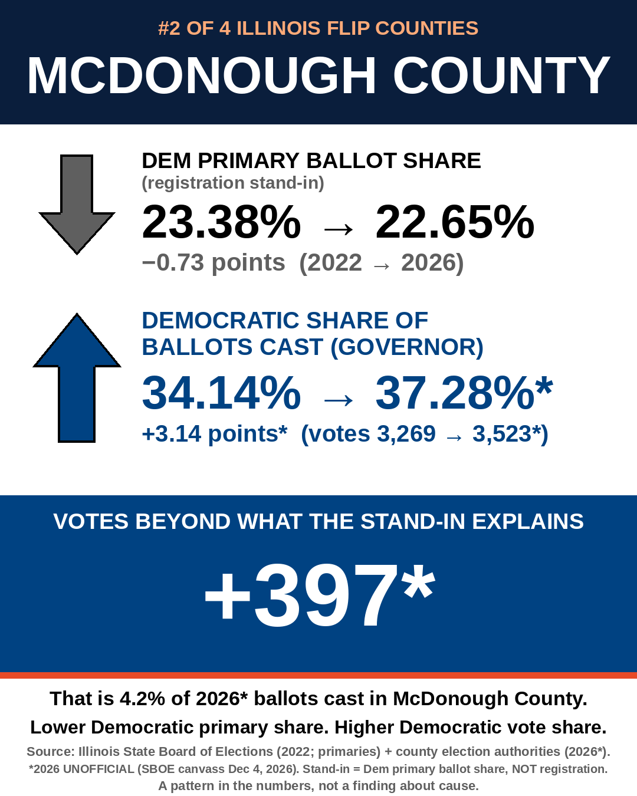
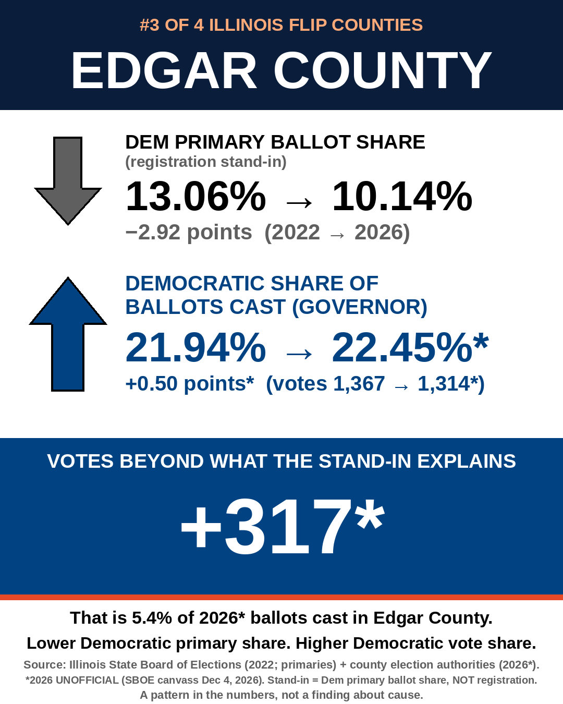
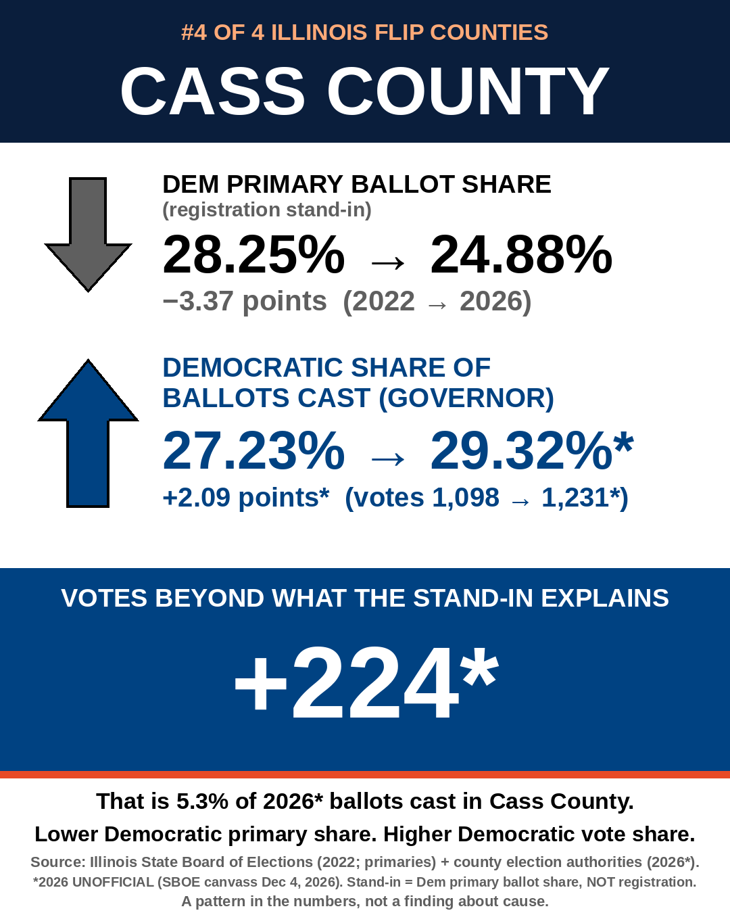
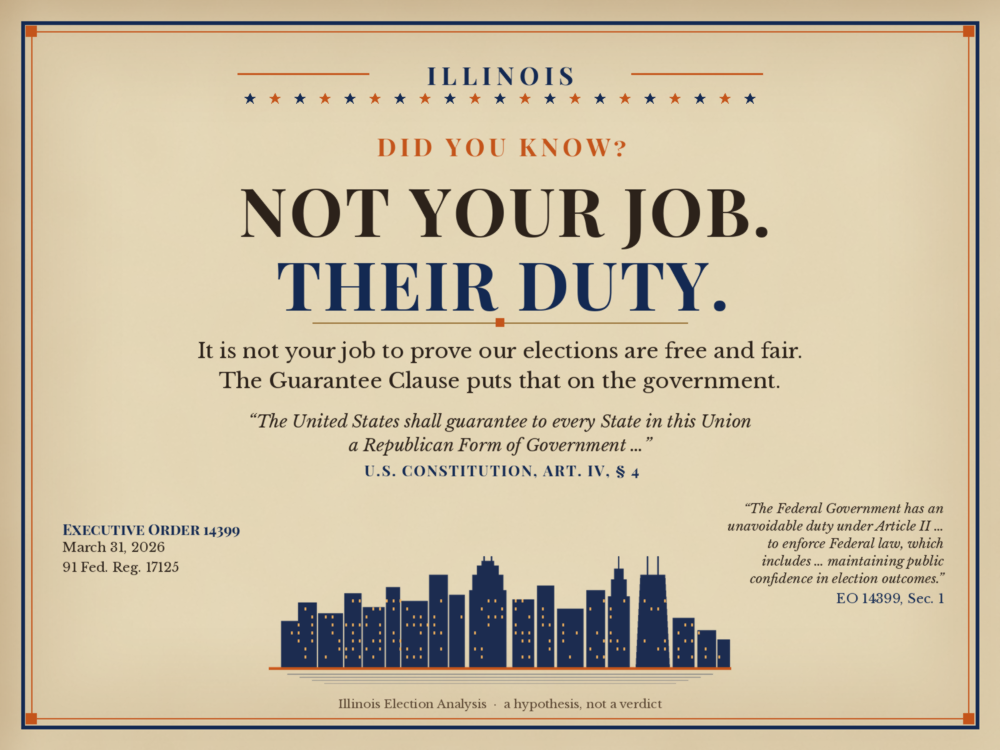

# Resources

> **\*2026 figures are UNOFFICIAL (pre-Dec 4, 2026 canvass).** The Illinois State Board of Elections (SBOE) has not yet posted 2026 general-election results; its official canvass is scheduled for December 4, 2026, so 2026 figures come from the results each county or municipal election authority posted. 2022 figures are the SBOE official canvass. **Registration stand-in: Democratic primary ballot share - NOT official party registration; Illinois has no party registration.** Wherever this wiki says D or "registration," it means Democratic primary ballots ÷ all primary ballots × 100, from the SBOE official 2022 and 2026 primary canvasses.

This page collects the documents, data sources, laws, equipment records, and graphics behind the Illinois Election Analysis in one place. Everything here is offered as analysis and as draft correspondence. Nothing on this page is an accusation against any county, election authority, official, or vendor.

## Letter to the Illinois Attorney General

A draft letter to Attorney General Kwame Raoul asking his office to say publicly whether cast vote records and ballot images from the November 3, 2026 general election are open to the public under the Illinois Freedom of Information Act (5 ILCS 140) once the canvass is complete, how the Act's exemption for information "specifically prohibited from disclosure by federal or State law" and its duty to release the remaining information (5 ILCS 140/7(1)) apply to a cast vote record that names no voter, and to help make sure 2026 election records are kept for the full 22-month federal period (52 U.S.C. § 20701), longer than the Election Code's 2-month ballot period (10 ILCS 5/17-20) and 60-day test-material period (10 ILCS 5/24B-9). It also asks the Public Access Counselor in his office to review any denial a member of the public brings to it (5 ILCS 140/9.5). It cites the Guarantee Clause (U.S. Const. art. IV, § 4) and the Article II enforcement-duty language in Executive Order 14399. It is respectful and non-accusatory, and it presents the Illinois analysis as a hypothesis, not proof. It is a draft for Morissa to review and send herself; it has not been sent.

- [Download the Attorney General letter (PDF)](https://raw.githubusercontent.com/mbenson8989/Illinois-Election-Analysis/main/Illinois_Attorney_General_Letter.pdf)
- [Download the Attorney General letter (Word)](https://raw.githubusercontent.com/mbenson8989/Illinois-Election-Analysis/main/Illinois_Attorney_General_Letter.docx)

Every quotation in the letter was checked word for word against the official text of the statute, order, or constitutional provision it quotes (Illinois General Assembly, ilga.gov; Federal Register / GovInfo; National Archives). The addressee and office address are from the [Office of the Illinois Attorney General](https://illinoisattorneygeneral.gov/) website (Chicago office, 115 S. LaSalle St., Chicago, IL 60603), retrieved November 24, 2026.

## County clerk letters

Illinois elections are run by **108 election authorities**, not 102. The [SBOE Election Authorities page](https://www.elections.il.gov/ElectionOperations/ElectionAuthorities.aspx) lists them: the county clerk in 101 counties, one county election commission (the **Peoria County Election Commission**, which runs elections for all of Peoria County), and **six municipal boards of election commissioners** that run elections inside their cities instead of the county clerk: **Chicago** (Cook County), **Rockford** (Winnebago), **Bloomington** (McLean), **Galesburg** (Knox), **Danville** (Vermilion), and **East St. Louis** (St. Clair). So there is one letter for each of the 108 authorities: 101 county clerk letters, 1 Peoria County Election Commission letter, and 6 board of election commissioners letters, in both PDF and Word. Voters in those six cities are served by the city board, so a county clerk letter alone would miss them. Each ZIP has a `PDF` folder and a `Word` folder. Pick your region, or download everything at once.

- **[Download all 108 Illinois election-authority letters (ZIP, 102 counties, 9.6 MB)](https://raw.githubusercontent.com/mbenson8989/Illinois-Election-Analysis/main/downloads/Illinois_Election_Authority_Letters_All_108.zip)**

By region:

- [Download Chicago & Cook County letters (ZIP, 1 county, 2 letters, 0.2 MB)](https://raw.githubusercontent.com/mbenson8989/Illinois-Election-Analysis/main/downloads/Illinois_Election_Authority_Letters_Region_1_Chicago_and_Cook.zip)
- [Download Collar Counties letters (ZIP, 5 counties, 5 letters, 0.4 MB)](https://raw.githubusercontent.com/mbenson8989/Illinois-Election-Analysis/main/downloads/Illinois_Election_Authority_Letters_Region_2_Collar_Counties.zip)
- [Download Northern Illinois letters (ZIP, 15 counties, 16 letters, 1.4 MB)](https://raw.githubusercontent.com/mbenson8989/Illinois-Election-Analysis/main/downloads/Illinois_Election_Authority_Letters_Region_3_Northern.zip)
- [Download Western Illinois letters (ZIP, 26 counties, 27 letters, 2.4 MB)](https://raw.githubusercontent.com/mbenson8989/Illinois-Election-Analysis/main/downloads/Illinois_Election_Authority_Letters_Region_4_Western.zip)
- [Download Central Illinois letters (ZIP, 21 counties, 23 letters, 2.1 MB)](https://raw.githubusercontent.com/mbenson8989/Illinois-Election-Analysis/main/downloads/Illinois_Election_Authority_Letters_Region_5_Central.zip)
- [Download Southern Illinois letters (ZIP, 34 counties, 35 letters, 3.1 MB)](https://raw.githubusercontent.com/mbenson8989/Illinois-Election-Analysis/main/downloads/Illinois_Election_Authority_Letters_Region_6_Southern.zip)

Not sure which region your county is in? [Download the county-to-region lookup (CSV)](https://raw.githubusercontent.com/mbenson8989/Illinois-Election-Analysis/main/downloads/Illinois_County_to_Region_Lookup.csv), or use the table below.

**How the counties are grouped.** The SBOE does not divide Illinois into election regions; each election authority runs its own elections. These six regions are an informal geographic grouping chosen for convenience, covering all 102 counties exactly once. The grouping has nothing to do with how the letters or the analysis were built.

**What each letter contains.** The letters follow Morissa's Nebraska cast-vote-record request letter, in the same tone and structure as the Kansas and Texas clerk letters, rewritten for Illinois law: the county's own 2022 and 2026\* figures for Democratic primary ballots and the Democratic primary share (the labeled stand-in), Democratic votes for governor, and total ballots cast (municipal-board letters use the county-wide figures for the county the city sits in, and say so); federal litigation context (no standing claimed); a Freedom of Information Act request for existing records only (cast vote record export, ballot images, precinct returns under 10 ILCS 5/24B-15, the 5% retabulation comparisons under 10 ILCS 5/24B-15, the test records under 10 ILCS 5/24B-9, and hash-verification records); a request to preserve 2026 records for the full 22-month federal period; a request, not a demand, for wider hand-count coverage that acknowledges the court-order rule for unsealing ballots after the proclamation; and blank date, signature, and sender lines. For the 22 counties without usable 2026\* results yet, the letter gives the 2022 and primary figures and says the 2026 comparison will follow. Addressees and mailing addresses come from the SBOE Election Authorities list, retrieved November 24, 2026. All 108 authorities had a name and address on that list, so no addressee is a placeholder. Please confirm each addressee against the authority's own website before sending, because officials change. Nothing has been mailed or emailed.

| Region | Counties | Letters | County list |
|---|---|---|---|
| 1. Chicago & Cook County | 1 | 2 | Cook |
| 2. Collar Counties | 5 | 5 | DuPage, Kane, Lake, McHenry, Will |
| 3. Northern Illinois | 15 | 16 | Boone, Bureau, Carroll, DeKalb, Grundy, Jo Daviess, Kankakee, Kendall, LaSalle, Lee, Ogle, Putnam, Stephenson, Whiteside, Winnebago |
| 4. Western Illinois | 26 | 27 | Adams, Brown, Calhoun, Cass, Fulton, Greene, Hancock, Henderson, Henry, Jersey, Knox, Marshall, Mason, McDonough, Menard, Mercer, Morgan, Peoria, Pike, Rock Island, Schuyler, Scott, Stark, Tazewell, Warren, Woodford |
| 5. Central Illinois | 21 | 23 | Champaign, Christian, Clark, Coles, Cumberland, De Witt, Douglas, Edgar, Ford, Iroquois, Livingston, Logan, Macon, Macoupin, McLean, Montgomery, Moultrie, Piatt, Sangamon, Shelby, Vermilion |
| 6. Southern Illinois | 34 | 35 | Alexander, Bond, Clay, Clinton, Crawford, Edwards, Effingham, Fayette, Franklin, Gallatin, Hamilton, Hardin, Jackson, Jasper, Jefferson, Johnson, Lawrence, Madison, Marion, Massac, Monroe, Perry, Pope, Pulaski, Randolph, Richland, Saline, St. Clair, Union, Wabash, Washington, Wayne, White, Williamson |

Municipal boards (letters included in their county's region): Chicago (Cook), Rockford (Winnebago), Bloomington (McLean), Galesburg (Knox), Danville (Vermilion), East St. Louis (St. Clair).

## Illinois State Board of Elections data sources

Every 2022 and primary number on this wiki comes from the Illinois State Board of Elections:

- **2022 general election (official):** [SBOE Download Vote Totals](https://www.elections.il.gov/ElectionOperations/DownloadVoteTotals.aspx): the 2022 General Election county vote file (`2022GECty`) and the official canvass PDF (`2022GEOfficialVote.pdf`); also browsable on [SBOE Election Vote Totals](https://www.elections.il.gov/ElectionOperations/ElectionVoteTotals.aspx)
- **Registration stand-in (official):** the SBOE official canvasses of the June 28, 2022 and March 17, 2026 general primaries (`2022GPCty`, `2022GPOfficialVote.pdf`, `2026GPOfficialVote.pdf`), from the same Download Vote Totals page. Democratic primary ballots ÷ all primary ballots, per county. *Stand-in, NOT official party registration; Illinois has no party registration.*
- **2026 general election (unofficial\*):** not yet posted by the SBOE (canvass December 4, 2026). County figures come from each election authority's own posted results; the source for every county is in the source column of [Bottom-Up Reverse Math](https://github.com/mbenson8989/Illinois-Election-Analysis/wiki/Reverse-Math) and in [`raw/sources.json`](https://github.com/mbenson8989/Illinois-Election-Analysis/blob/main/raw/sources.json).
- **Election authorities:** [SBOE Election Authorities](https://www.elections.il.gov/ElectionOperations/ElectionAuthorities.aspx) ("All Election Authorities" view), used for the letter addressees

County populations (used only to sort the tables) are 2020 Census (PL 94-171) counts.

## County-level results

- [Download the PDF report](https://raw.githubusercontent.com/mbenson8989/Illinois-Election-Analysis/main/report/Illinois_Reverse_Factoring_Report_UNOFFICIAL_2026.pdf): every county's stand-in, Democratic share, surplus, and change, 2022 vs 2026\*, with the locked equation and verification
- [2022 governor results by county, verified (CSV)](https://raw.githubusercontent.com/mbenson8989/Illinois-Election-Analysis/main/out/il_2022_governor_by_county_VERIFIED.csv): SBOE official 2022 governor votes and ballots cast, all 102 counties
- [2022 vs 2026\* reverse math by county, verified (CSV)](https://raw.githubusercontent.com/mbenson8989/Illinois-Election-Analysis/main/out/il_governor_reverse_math_2022_2026_VERIFIED.csv): stand-in, Democratic shares, gaps, residuals and each county's 2026 source
- [Surplus-form county table (CSV)](https://raw.githubusercontent.com/mbenson8989/Illinois-Election-Analysis/main/out/surplus_pass_a.csv): S, D and residuals for the [Locked Illinois Formula](https://github.com/mbenson8989/Illinois-Election-Analysis/wiki/Locked-Illinois-Formula)
- Step-by-step county arithmetic: [Bottom-Up Reverse Math](https://github.com/mbenson8989/Illinois-Election-Analysis/wiki/Reverse-Math); top and bottom counties: [Floor and Ceiling Counties](https://github.com/mbenson8989/Illinois-Election-Analysis/wiki/Floor-and-Ceiling)

## Voting equipment by county

This table lists the in-person and mail-ballot equipment Verified Voting records for each of Illinois's 108 election authorities: the 102 counties and the six municipal boards of election commissioners. It is offered as background on how ballots are marked and counted. **Equipment information is context only. It is not evidence of wrongdoing, and a vendor name does not imply a problem with any jurisdiction's results.**

**Source.** [Verified Voting's Verifier](https://verifiedvoting.org/verifier/): the public CSV download for Illinois (state FIPS 17), years 2026 and 2022, retrieved 2026-11-24 11:48 CST (America/Chicago). Verified Voting's 2026 Illinois export is labeled *The Verifier - November 2026 / Illinois. Data as of November 24, 2026.* It lists 108 Illinois jurisdictions, the same 108 election authorities the SBOE lists. Verified Voting's "Cook County" record is the suburban Cook County Clerk's jurisdiction; Chicago is its own record, and the same split applies to the other five cities. Counties are sorted by 2020 Census population, largest to smallest, like the other Illinois tables; the six city boards follow, sorted by Verified Voting's registered-voter count.

**Confirmed vs. unconfirmed.** A jurisdiction is marked *Confirmed* when Verified Voting's 2026 record lists an election-day tabulator for it. All 108 meet that test; **0 are unconfirmed**.

### Statewide vendor summary (2026 election-day tabulators)

Counts use the election-day tabulator Verified Voting lists for each jurisdiction. Ballot-marking devices, poll books, and the remote ballot-marking systems for military, overseas, and disabled voters are not counted as the election-day tabulator. Registered voters are Verified Voting's figures, so the city boards and the rest of their counties are not double-counted.

- **ES&S:** 45 election authorities (40 counties and 5 city boards); 2,365,370 registered voters (29.1% of the 8,115,252 Verified Voting lists statewide)
- **Unisyn:** 35 election authorities (35 counties); 803,056 registered voters (9.9% of the 8,115,252 Verified Voting lists statewide)
- **Hart InterCivic:** 26 election authorities (26 counties); 1,782,883 registered voters (22.0% of the 8,115,252 Verified Voting lists statewide)
- **Liberty Vote (Dominion):** 2 election authorities (1 counties and 1 city board); 3,163,943 registered voters (39.0% of the 8,115,252 Verified Voting lists statewide)

No jurisdiction lists more than one election-day tabulator vendor. Marking method: 107 jurisdictions use hand-marked paper ballots with ballot-marking devices (BMDs) available, and 1 uses BMDs for all voters (Kane).

The downloadable CSV also records each jurisdiction's poll book, 2022 election-day tabulator equipment, status, source link, and notes.

### Download the full table

- CSV (all 108 election authorities and all columns): [IL_108_Authority_Voting_Equipment_VerifiedVoting.csv](https://raw.githubusercontent.com/mbenson8989/Illinois-Election-Analysis/main/IL_108_Authority_Voting_Equipment_VerifiedVoting.csv) (raw download link)

### All 102 counties, largest to smallest

| Jurisdiction | Population 2020 | Registered voters (VV) | Marking method | ED tabulator vendor | ED tabulator equipment | Mail tabulator equipment | Accessible device | Paper record / VVPAT | Software/firmware | Status | Source | Notes |
| --- | --- | --- | --- | --- | --- | --- | --- | --- | --- | --- | --- | --- |
| Cook | 5,275,541 | 1,665,034 | Hand marked paper ballots and BMDs | Liberty Vote (Dominion) | Liberty Vote (Dominion) ImageCast Precinct (Hand-Fed Optical Scanner) | Liberty Vote (Dominion) ImageCast Central (Batch-Fed Optical Scanner) | Liberty Vote (Dominion) ImageCast X BMD (Ballot Marking Device) | VVPAT: N/A (Verified Voting does not list a VVPAT for these systems) | Not listed by Verified Voting | Confirmed (Verified Voting 2026 record) | [Verifier](https://verifiedvoting.org/verifier/#mode/navigate/map/ppEquip/mapType/normal/year/2026/state/17/county/031) | Same election-day tabulator model as 2022; manufacturer name changed in Verified Voting from Dominion to Liberty Vote (Dominion). |
| DuPage | 932,877 | 631,995 | Hand marked paper ballots and BMDs | Hart InterCivic | Hart InterCivic Verity Scan (Hand-Fed Optical Scanner) | Hart InterCivic Verity Central (Batch-Fed Optical Scanner) | Hart InterCivic Verity Touch Writer (Ballot Marking Device) | VVPAT: N/A (Verified Voting does not list a VVPAT for these systems) | Not listed by Verified Voting | Confirmed (Verified Voting 2026 record) | [Verifier](https://verifiedvoting.org/verifier/#mode/navigate/map/ppEquip/mapType/normal/year/2026/state/17/county/043) |  |
| Lake | 714,342 | 464,526 | Hand marked paper ballots and BMDs | ES&S | ES&S DS200 (Hand-Fed Optical Scanner) | ES&S DS450 (Batch-Fed Optical Scanner); ES&S DS850 (Batch-Fed Optical Scanner) | ES&S ExpressVote (Ballot Marking Device) | VVPAT: N/A (Verified Voting does not list a VVPAT for these systems) | Not listed by Verified Voting | Confirmed (Verified Voting 2026 record) | [Verifier](https://verifiedvoting.org/verifier/#mode/navigate/map/ppEquip/mapType/normal/year/2026/state/17/county/097) |  |
| Will | 696,355 | 428,909 | Hand marked paper ballots and BMDs | Hart InterCivic | Hart InterCivic Verity Scan (Hand-Fed Optical Scanner) | Hart InterCivic Verity Central (Batch-Fed Optical Scanner) | Hart InterCivic Verity Touch Writer (Ballot Marking Device) | VVPAT: N/A (Verified Voting does not list a VVPAT for these systems) | Not listed by Verified Voting | Confirmed (Verified Voting 2026 record) | [Verifier](https://verifiedvoting.org/verifier/#mode/navigate/map/ppEquip/mapType/normal/year/2026/state/17/county/197) | Election-day tabulator equipment changed from 2022: ES&S Model 100 (Hand-Fed Optical Scanner). |
| Kane | 516,522 | 308,025 | Ballot Marking Devices for all voters | Hart InterCivic | Hart InterCivic Verity Scan (Hand-Fed Optical Scanner) | Hart InterCivic Verity Central (Batch-Fed Optical Scanner) | Hart InterCivic Verity Duo (Ballot Marking Device) | VVPAT: N/A (Verified Voting does not list a VVPAT for these systems) | Not listed by Verified Voting | Confirmed (Verified Voting 2026 record) | [Verifier](https://verifiedvoting.org/verifier/#mode/navigate/map/ppEquip/mapType/normal/year/2026/state/17/county/089) | Verified Voting's 2022 record lists no election-day tabulator, so no 2022 comparison is possible. |
| McHenry | 310,229 | 210,472 | Hand marked paper ballots and BMDs | ES&S | ES&S DS200 (Hand-Fed Optical Scanner) | ES&S DS850 (Batch-Fed Optical Scanner) | ES&S ExpressVote (Ballot Marking Device) | VVPAT: N/A (Verified Voting does not list a VVPAT for these systems) | Not listed by Verified Voting | Confirmed (Verified Voting 2026 record) | [Verifier](https://verifiedvoting.org/verifier/#mode/navigate/map/ppEquip/mapType/normal/year/2026/state/17/county/111) |  |
| Winnebago | 285,350 | 94,896 | Hand marked paper ballots and BMDs | ES&S | ES&S DS200 (Hand-Fed Optical Scanner) | ES&S DS450 (Batch-Fed Optical Scanner) | ES&S ExpressVote (Ballot Marking Device) | VVPAT: N/A (Verified Voting does not list a VVPAT for these systems) | Not listed by Verified Voting | Confirmed (Verified Voting 2026 record) | [Verifier](https://verifiedvoting.org/verifier/#mode/navigate/map/ppEquip/mapType/normal/year/2026/state/17/county/201) |  |
| Madison | 265,859 | 184,284 | Hand marked paper ballots and BMDs | ES&S | ES&S DS200 (Hand-Fed Optical Scanner) | ES&S DS200 (Hand-Fed Optical Scanner) | ES&S ExpressVote (Ballot Marking Device) | VVPAT: N/A (Verified Voting does not list a VVPAT for these systems) | Not listed by Verified Voting | Confirmed (Verified Voting 2026 record) | [Verifier](https://verifiedvoting.org/verifier/#mode/navigate/map/ppEquip/mapType/normal/year/2026/state/17/county/119) |  |
| St. Clair | 257,400 | 168,619 | Hand marked paper ballots and BMDs | ES&S | ES&S DS200 (Hand-Fed Optical Scanner) | ES&S DS450 (Batch-Fed Optical Scanner) | ES&S ExpressVote (Ballot Marking Device) | VVPAT: N/A (Verified Voting does not list a VVPAT for these systems) | Not listed by Verified Voting | Confirmed (Verified Voting 2026 record) | [Verifier](https://verifiedvoting.org/verifier/#mode/navigate/map/ppEquip/mapType/normal/year/2026/state/17/county/163) |  |
| Champaign | 205,865 | 122,822 | Hand marked paper ballots and BMDs | ES&S | ES&S DS200 (Hand-Fed Optical Scanner) | ES&S DS200 (Hand-Fed Optical Scanner) | ES&S ExpressVote (Ballot Marking Device) | VVPAT: N/A (Verified Voting does not list a VVPAT for these systems) | Not listed by Verified Voting | Confirmed (Verified Voting 2026 record) | [Verifier](https://verifiedvoting.org/verifier/#mode/navigate/map/ppEquip/mapType/normal/year/2026/state/17/county/019) |  |
| Sangamon | 196,343 | 139,246 | Hand marked paper ballots and BMDs | ES&S | ES&S DS200 (Hand-Fed Optical Scanner) | ES&S DS200 (Hand-Fed Optical Scanner) | ES&S ExpressVote (Ballot Marking Device) | VVPAT: N/A (Verified Voting does not list a VVPAT for these systems) | Not listed by Verified Voting | Confirmed (Verified Voting 2026 record) | [Verifier](https://verifiedvoting.org/verifier/#mode/navigate/map/ppEquip/mapType/normal/year/2026/state/17/county/167) | Election-day tabulator equipment changed from 2022: ES&S Model 100 (Hand-Fed Optical Scanner). |
| Peoria | 181,830 | 117,790 | Hand marked paper ballots and BMDs | Hart InterCivic | Hart InterCivic Verity Scan (Hand-Fed Optical Scanner) | Hart InterCivic Verity Central (Batch-Fed Optical Scanner) | Hart InterCivic Verity Touch Writer (Ballot Marking Device) | VVPAT: N/A (Verified Voting does not list a VVPAT for these systems) | Not listed by Verified Voting | Confirmed (Verified Voting 2026 record) | [Verifier](https://verifiedvoting.org/verifier/#mode/navigate/map/ppEquip/mapType/normal/year/2026/state/17/county/143) |  |
| McLean | 170,954 | 67,406 | Hand marked paper ballots and BMDs | ES&S | ES&S DS200 (Hand-Fed Optical Scanner) | ES&S DS200 (Hand-Fed Optical Scanner); ES&S DS450 (Batch-Fed Optical Scanner) | ES&S ExpressVote (Ballot Marking Device) | VVPAT: N/A (Verified Voting does not list a VVPAT for these systems) | Not listed by Verified Voting | Confirmed (Verified Voting 2026 record) | [Verifier](https://verifiedvoting.org/verifier/#mode/navigate/map/ppEquip/mapType/normal/year/2026/state/17/county/113) |  |
| Rock Island | 144,672 | 86,205 | Hand marked paper ballots and BMDs | ES&S | ES&S DS200 (Hand-Fed Optical Scanner) | ES&S DS200 (Hand-Fed Optical Scanner) | ES&S ExpressVote (Ballot Marking Device) | VVPAT: N/A (Verified Voting does not list a VVPAT for these systems) | Not listed by Verified Voting | Confirmed (Verified Voting 2026 record) | [Verifier](https://verifiedvoting.org/verifier/#mode/navigate/map/ppEquip/mapType/normal/year/2026/state/17/county/161) | Election-day tabulator equipment changed from 2022: Premier (Diebold) AccuVote OS (Hand-Fed Optical Scanner). |
| Kendall | 131,869 | 91,622 | Hand marked paper ballots and BMDs | ES&S | ES&S DS200 (Hand-Fed Optical Scanner) | ES&S DS200 (Hand-Fed Optical Scanner) | ES&S AutoMARK (Ballot Marking Device) | VVPAT: N/A (Verified Voting does not list a VVPAT for these systems) | Not listed by Verified Voting | Confirmed (Verified Voting 2026 record) | [Verifier](https://verifiedvoting.org/verifier/#mode/navigate/map/ppEquip/mapType/normal/year/2026/state/17/county/093) | Election-day tabulator equipment changed from 2022: ES&S Model 100 (Hand-Fed Optical Scanner). |
| Tazewell | 131,343 | 91,651 | Hand marked paper ballots and BMDs | Unisyn | Unisyn OpenElect OVO (Hand-Fed Optical Scanner) | Unisyn OpenElect OVO (Hand-Fed Optical Scanner) | Unisyn OpenElect FVT (Ballot Marking Device) | VVPAT: N/A (Verified Voting does not list a VVPAT for these systems) | Not listed by Verified Voting | Confirmed (Verified Voting 2026 record) | [Verifier](https://verifiedvoting.org/verifier/#mode/navigate/map/ppEquip/mapType/normal/year/2026/state/17/county/179) |  |
| LaSalle | 109,658 | 74,752 | Hand marked paper ballots and BMDs | Unisyn | Unisyn OpenElect FVS (Hand-Fed Optical Scanner) | Unisyn OpenElect FVS (Hand-Fed Optical Scanner) | Unisyn OpenElect FVT (Ballot Marking Device) | VVPAT: N/A (Verified Voting does not list a VVPAT for these systems) | Not listed by Verified Voting | Confirmed (Verified Voting 2026 record) | [Verifier](https://verifiedvoting.org/verifier/#mode/navigate/map/ppEquip/mapType/normal/year/2026/state/17/county/099) | Election-day tabulator equipment changed from 2022: ES&S Model 100 (Hand-Fed Optical Scanner). |
| Kankakee | 107,502 | 68,517 | Hand marked paper ballots and BMDs | Unisyn | Unisyn OpenElect OVO (Hand-Fed Optical Scanner) | Unisyn OpenElect OVO (Hand-Fed Optical Scanner) | Unisyn OpenElect FVT (Ballot Marking Device) | VVPAT: N/A (Verified Voting does not list a VVPAT for these systems) | Not listed by Verified Voting | Confirmed (Verified Voting 2026 record) | [Verifier](https://verifiedvoting.org/verifier/#mode/navigate/map/ppEquip/mapType/normal/year/2026/state/17/county/091) |  |
| Macon | 103,998 | 67,218 | Hand marked paper ballots and BMDs | Unisyn | Unisyn OpenElect FVS (Hand-Fed Optical Scanner) | Unisyn OpenElect FVS (Hand-Fed Optical Scanner) | Unisyn OpenElect FVT (Ballot Marking Device) | VVPAT: N/A (Verified Voting does not list a VVPAT for these systems) | Not listed by Verified Voting | Confirmed (Verified Voting 2026 record) | [Verifier](https://verifiedvoting.org/verifier/#mode/navigate/map/ppEquip/mapType/normal/year/2026/state/17/county/115) | Election-day tabulator equipment changed from 2022: Unisyn OpenElect OVO (Hand-Fed Optical Scanner). |
| DeKalb | 100,420 | 65,805 | Hand marked paper ballots and BMDs | ES&S | ES&S DS200 (Hand-Fed Optical Scanner) | ES&S DS200 (Hand-Fed Optical Scanner) | ES&S ExpressVote (Ballot Marking Device) | VVPAT: N/A (Verified Voting does not list a VVPAT for these systems) | Not listed by Verified Voting | Confirmed (Verified Voting 2026 record) | [Verifier](https://verifiedvoting.org/verifier/#mode/navigate/map/ppEquip/mapType/normal/year/2026/state/17/county/037) |  |
| Vermilion | 74,188 | 27,333 | Hand marked paper ballots and BMDs | Unisyn | Unisyn OpenElect OVO (Hand-Fed Optical Scanner) | Unisyn OpenElect OVO (Hand-Fed Optical Scanner) | Unisyn OpenElect FVT (Ballot Marking Device) | VVPAT: N/A (Verified Voting does not list a VVPAT for these systems) | Not listed by Verified Voting | Confirmed (Verified Voting 2026 record) | [Verifier](https://verifiedvoting.org/verifier/#mode/navigate/map/ppEquip/mapType/normal/year/2026/state/17/county/183) |  |
| Williamson | 67,153 | 48,182 | Hand marked paper ballots and BMDs | ES&S | ES&S DS200 (Hand-Fed Optical Scanner) | ES&S DS200 (Hand-Fed Optical Scanner) | ES&S ExpressVote (Ballot Marking Device) | VVPAT: N/A (Verified Voting does not list a VVPAT for these systems) | Not listed by Verified Voting | Confirmed (Verified Voting 2026 record) | [Verifier](https://verifiedvoting.org/verifier/#mode/navigate/map/ppEquip/mapType/normal/year/2026/state/17/county/199) | Election-day tabulator equipment changed from 2022: ES&S Model 100 (Hand-Fed Optical Scanner). |
| Adams | 65,737 | 44,627 | Hand marked paper ballots and BMDs | ES&S | ES&S DS200 (Hand-Fed Optical Scanner) | ES&S DS200 (Hand-Fed Optical Scanner) | ES&S ExpressVote (Ballot Marking Device) | VVPAT: N/A (Verified Voting does not list a VVPAT for these systems) | Not listed by Verified Voting | Confirmed (Verified Voting 2026 record) | [Verifier](https://verifiedvoting.org/verifier/#mode/navigate/map/ppEquip/mapType/normal/year/2026/state/17/county/001) |  |
| Whiteside | 55,691 | 36,572 | Hand marked paper ballots and BMDs | Unisyn | Unisyn OpenElect OVO (Hand-Fed Optical Scanner) | Unisyn OpenElect OVO (Hand-Fed Optical Scanner) | Unisyn OpenElect FVT (Ballot Marking Device) | VVPAT: N/A (Verified Voting does not list a VVPAT for these systems) | Not listed by Verified Voting | Confirmed (Verified Voting 2026 record) | [Verifier](https://verifiedvoting.org/verifier/#mode/navigate/map/ppEquip/mapType/normal/year/2026/state/17/county/195) |  |
| Boone | 53,448 | 34,153 | Hand marked paper ballots and BMDs | Unisyn | Unisyn OpenElect OVO (Hand-Fed Optical Scanner) | Unisyn OpenElect OVO (Hand-Fed Optical Scanner) | Unisyn OpenElect FVT (Ballot Marking Device) | VVPAT: N/A (Verified Voting does not list a VVPAT for these systems) | Not listed by Verified Voting | Confirmed (Verified Voting 2026 record) | [Verifier](https://verifiedvoting.org/verifier/#mode/navigate/map/ppEquip/mapType/normal/year/2026/state/17/county/007) |  |
| Jackson | 52,974 | 32,515 | Hand marked paper ballots and BMDs | Hart InterCivic | Hart InterCivic Verity Scan (Hand-Fed Optical Scanner) | Hart InterCivic Verity Scan (Hand-Fed Optical Scanner) | Hart InterCivic Verity Touch Writer (Ballot Marking Device) | VVPAT: N/A (Verified Voting does not list a VVPAT for these systems) | Not listed by Verified Voting | Confirmed (Verified Voting 2026 record) | [Verifier](https://verifiedvoting.org/verifier/#mode/navigate/map/ppEquip/mapType/normal/year/2026/state/17/county/077) | Election-day tabulator equipment changed from 2022: Premier (Diebold) AccuVote OS (Hand-Fed Optical Scanner). |
| Grundy | 52,533 | 35,856 | Hand marked paper ballots and BMDs | Hart InterCivic | Hart InterCivic Verity Scan (Hand-Fed Optical Scanner) | Hart InterCivic Verity Scan (Hand-Fed Optical Scanner) | Hart InterCivic Verity Touch Writer (Ballot Marking Device) | VVPAT: N/A (Verified Voting does not list a VVPAT for these systems) | Not listed by Verified Voting | Confirmed (Verified Voting 2026 record) | [Verifier](https://verifiedvoting.org/verifier/#mode/navigate/map/ppEquip/mapType/normal/year/2026/state/17/county/063) |  |
| Ogle | 51,788 | 34,483 | Hand marked paper ballots and BMDs | Unisyn | Unisyn OpenElect OVO (Hand-Fed Optical Scanner) | Unisyn OpenElect OVO (Hand-Fed Optical Scanner) | Unisyn OpenElect FVT (Ballot Marking Device) | VVPAT: N/A (Verified Voting does not list a VVPAT for these systems) | Not listed by Verified Voting | Confirmed (Verified Voting 2026 record) | [Verifier](https://verifiedvoting.org/verifier/#mode/navigate/map/ppEquip/mapType/normal/year/2026/state/17/county/141) |  |
| Knox | 49,967 | 14,656 | Hand marked paper ballots and BMDs | Hart InterCivic | Hart InterCivic Verity Scan (Hand-Fed Optical Scanner) | Hart InterCivic Verity Scan (Hand-Fed Optical Scanner) | Hart InterCivic Verity Touch Writer (Ballot Marking Device) | VVPAT: N/A (Verified Voting does not list a VVPAT for these systems) | Not listed by Verified Voting | Confirmed (Verified Voting 2026 record) | [Verifier](https://verifiedvoting.org/verifier/#mode/navigate/map/ppEquip/mapType/normal/year/2026/state/17/county/095) | Election-day tabulator equipment changed from 2022: Premier (Diebold) AccuVote OS (Hand-Fed Optical Scanner). |
| Henry | 49,284 | 36,350 | Hand marked paper ballots and BMDs | ES&S | ES&S DS200 (Hand-Fed Optical Scanner) | ES&S DS200 (Hand-Fed Optical Scanner) | ES&S ExpressVote (Ballot Marking Device) | VVPAT: N/A (Verified Voting does not list a VVPAT for these systems) | Not listed by Verified Voting | Confirmed (Verified Voting 2026 record) | [Verifier](https://verifiedvoting.org/verifier/#mode/navigate/map/ppEquip/mapType/normal/year/2026/state/17/county/073) |  |
| Coles | 46,863 | 29,069 | Hand marked paper ballots and BMDs | Unisyn | Unisyn OpenElect OVO (Hand-Fed Optical Scanner) | Unisyn OpenElect OVO (Hand-Fed Optical Scanner) | Unisyn OpenElect FVT (Ballot Marking Device) | VVPAT: N/A (Verified Voting does not list a VVPAT for these systems) | Not listed by Verified Voting | Confirmed (Verified Voting 2026 record) | [Verifier](https://verifiedvoting.org/verifier/#mode/navigate/map/ppEquip/mapType/normal/year/2026/state/17/county/029) |  |
| Macoupin | 44,967 | 30,760 | Hand marked paper ballots and BMDs | Unisyn | Unisyn OpenElect FVS (Hand-Fed Optical Scanner) | Unisyn OpenElect FVS (Hand-Fed Optical Scanner) | Unisyn OpenElect FVT (Ballot Marking Device) | VVPAT: N/A (Verified Voting does not list a VVPAT for these systems) | Not listed by Verified Voting | Confirmed (Verified Voting 2026 record) | [Verifier](https://verifiedvoting.org/verifier/#mode/navigate/map/ppEquip/mapType/normal/year/2026/state/17/county/117) | Election-day tabulator equipment changed from 2022: Unisyn OpenElect OVO (Hand-Fed Optical Scanner). |
| Stephenson | 44,630 | 26,895 | Hand marked paper ballots and BMDs | Unisyn | Unisyn OpenElect OVO (Hand-Fed Optical Scanner) | Unisyn OpenElect OVO (Hand-Fed Optical Scanner) | Unisyn OpenElect FVT (Ballot Marking Device) | VVPAT: N/A (Verified Voting does not list a VVPAT for these systems) | Not listed by Verified Voting | Confirmed (Verified Voting 2026 record) | [Verifier](https://verifiedvoting.org/verifier/#mode/navigate/map/ppEquip/mapType/normal/year/2026/state/17/county/177) |  |
| Woodford | 38,467 | 27,442 | Hand marked paper ballots and BMDs | ES&S | ES&S DS200 (Hand-Fed Optical Scanner) | ES&S DS200 (Hand-Fed Optical Scanner) | ES&S ExpressVote (Ballot Marking Device) | VVPAT: N/A (Verified Voting does not list a VVPAT for these systems) | Not listed by Verified Voting | Confirmed (Verified Voting 2026 record) | [Verifier](https://verifiedvoting.org/verifier/#mode/navigate/map/ppEquip/mapType/normal/year/2026/state/17/county/203) |  |
| Franklin | 37,804 | 29,055 | Hand marked paper ballots and BMDs | ES&S | ES&S DS200 (Hand-Fed Optical Scanner) | ES&S DS200 (Hand-Fed Optical Scanner) | ES&S ExpressVote (Ballot Marking Device) | VVPAT: N/A (Verified Voting does not list a VVPAT for these systems) | Not listed by Verified Voting | Confirmed (Verified Voting 2026 record) | [Verifier](https://verifiedvoting.org/verifier/#mode/navigate/map/ppEquip/mapType/normal/year/2026/state/17/county/055) |  |
| Marion | 37,729 | 25,229 | Hand marked paper ballots and BMDs | ES&S | ES&S DS200 (Hand-Fed Optical Scanner) | ES&S DS200 (Hand-Fed Optical Scanner) | ES&S ExpressVote (Ballot Marking Device) | VVPAT: N/A (Verified Voting does not list a VVPAT for these systems) | Not listed by Verified Voting | Confirmed (Verified Voting 2026 record) | [Verifier](https://verifiedvoting.org/verifier/#mode/navigate/map/ppEquip/mapType/normal/year/2026/state/17/county/121) |  |
| Jefferson | 37,113 | 24,022 | Hand marked paper ballots and BMDs | ES&S | ES&S DS200 (Hand-Fed Optical Scanner) | ES&S DS200 (Hand-Fed Optical Scanner) | ES&S ExpressVote (Ballot Marking Device) | VVPAT: N/A (Verified Voting does not list a VVPAT for these systems) | Not listed by Verified Voting | Confirmed (Verified Voting 2026 record) | [Verifier](https://verifiedvoting.org/verifier/#mode/navigate/map/ppEquip/mapType/normal/year/2026/state/17/county/081) |  |
| Clinton | 36,899 | 25,960 | Hand marked paper ballots and BMDs | ES&S | ES&S DS200 (Hand-Fed Optical Scanner) | ES&S DS200 (Hand-Fed Optical Scanner) | ES&S ExpressVote (Ballot Marking Device) | VVPAT: N/A (Verified Voting does not list a VVPAT for these systems) | Not listed by Verified Voting | Confirmed (Verified Voting 2026 record) | [Verifier](https://verifiedvoting.org/verifier/#mode/navigate/map/ppEquip/mapType/normal/year/2026/state/17/county/027) |  |
| Livingston | 35,815 | 20,758 | Hand marked paper ballots and BMDs | Unisyn | Unisyn OpenElect OVO (Hand-Fed Optical Scanner) | Unisyn OpenElect OVO (Hand-Fed Optical Scanner) | Unisyn OpenElect FVT (Ballot Marking Device) | VVPAT: N/A (Verified Voting does not list a VVPAT for these systems) | Not listed by Verified Voting | Confirmed (Verified Voting 2026 record) | [Verifier](https://verifiedvoting.org/verifier/#mode/navigate/map/ppEquip/mapType/normal/year/2026/state/17/county/105) |  |
| Monroe | 34,962 | 26,339 | Hand marked paper ballots and BMDs | ES&S | ES&S DS200 (Hand-Fed Optical Scanner) | ES&S DS200 (Hand-Fed Optical Scanner) | ES&S ExpressVote (Ballot Marking Device) | VVPAT: N/A (Verified Voting does not list a VVPAT for these systems) | Not listed by Verified Voting | Confirmed (Verified Voting 2026 record) | [Verifier](https://verifiedvoting.org/verifier/#mode/navigate/map/ppEquip/mapType/normal/year/2026/state/17/county/133) |  |
| Effingham | 34,668 | 24,465 | Hand marked paper ballots and BMDs | ES&S | ES&S DS200 (Hand-Fed Optical Scanner) | ES&S DS200 (Hand-Fed Optical Scanner) | ES&S ExpressVote (Ballot Marking Device) | VVPAT: N/A (Verified Voting does not list a VVPAT for these systems) | Not listed by Verified Voting | Confirmed (Verified Voting 2026 record) | [Verifier](https://verifiedvoting.org/verifier/#mode/navigate/map/ppEquip/mapType/normal/year/2026/state/17/county/049) |  |
| Lee | 34,145 | 21,415 | Hand marked paper ballots and BMDs | Unisyn | Unisyn OpenElect OVO (Hand-Fed Optical Scanner) | Unisyn OpenElect OVO (Hand-Fed Optical Scanner) | Unisyn OpenElect FVT (Ballot Marking Device) | VVPAT: N/A (Verified Voting does not list a VVPAT for these systems) | Not listed by Verified Voting | Confirmed (Verified Voting 2026 record) | [Verifier](https://verifiedvoting.org/verifier/#mode/navigate/map/ppEquip/mapType/normal/year/2026/state/17/county/103) |  |
| Christian | 34,032 | 10,767 | Hand marked paper ballots and BMDs | Unisyn | Unisyn OpenElect OVO (Hand-Fed Optical Scanner) | Unisyn OpenElect OVO (Hand-Fed Optical Scanner) | Unisyn OpenElect FVT (Ballot Marking Device) | VVPAT: N/A (Verified Voting does not list a VVPAT for these systems) | Not listed by Verified Voting | Confirmed (Verified Voting 2026 record) | [Verifier](https://verifiedvoting.org/verifier/#mode/navigate/map/ppEquip/mapType/normal/year/2026/state/17/county/021) |  |
| Fulton | 33,609 | 24,741 | Hand marked paper ballots and BMDs | Hart InterCivic | Hart InterCivic Verity Scan (Hand-Fed Optical Scanner) | Hart InterCivic Verity Scan (Hand-Fed Optical Scanner) | Hart InterCivic Verity Touch Writer (Ballot Marking Device) | VVPAT: N/A (Verified Voting does not list a VVPAT for these systems) | Not listed by Verified Voting | Confirmed (Verified Voting 2026 record) | [Verifier](https://verifiedvoting.org/verifier/#mode/navigate/map/ppEquip/mapType/normal/year/2026/state/17/county/057) | Election-day tabulator equipment changed from 2022: Premier (Diebold) AccuVote OS (Hand-Fed Optical Scanner). |
| Bureau | 33,244 | 22,738 | Hand marked paper ballots and BMDs | Unisyn | Unisyn OpenElect OVO (Hand-Fed Optical Scanner) | Unisyn OpenElect OVO (Hand-Fed Optical Scanner) | Unisyn OpenElect FVT (Ballot Marking Device) | VVPAT: N/A (Verified Voting does not list a VVPAT for these systems) | Not listed by Verified Voting | Confirmed (Verified Voting 2026 record) | [Verifier](https://verifiedvoting.org/verifier/#mode/navigate/map/ppEquip/mapType/normal/year/2026/state/17/county/011) |  |
| Morgan | 32,915 | 22,336 | Hand marked paper ballots and BMDs | Hart InterCivic | Hart InterCivic Verity Scan (Hand-Fed Optical Scanner) | Hart InterCivic Verity Scan (Hand-Fed Optical Scanner) | Hart InterCivic Verity Touch Writer (Ballot Marking Device) | VVPAT: N/A (Verified Voting does not list a VVPAT for these systems) | Not listed by Verified Voting | Confirmed (Verified Voting 2026 record) | [Verifier](https://verifiedvoting.org/verifier/#mode/navigate/map/ppEquip/mapType/normal/year/2026/state/17/county/137) |  |
| Randolph | 30,163 | 20,290 | Hand marked paper ballots and BMDs | ES&S | ES&S DS200 (Hand-Fed Optical Scanner) | ES&S DS200 (Hand-Fed Optical Scanner) | ES&S ExpressVote (Ballot Marking Device) | VVPAT: N/A (Verified Voting does not list a VVPAT for these systems) | Not listed by Verified Voting | Confirmed (Verified Voting 2026 record) | [Verifier](https://verifiedvoting.org/verifier/#mode/navigate/map/ppEquip/mapType/normal/year/2026/state/17/county/157) |  |
| Montgomery | 28,288 | 16,956 | Hand marked paper ballots and BMDs | Unisyn | Unisyn OpenElect OVO (Hand-Fed Optical Scanner) | Unisyn OpenElect OVO (Hand-Fed Optical Scanner) | Unisyn OpenElect FVT (Ballot Marking Device) | VVPAT: N/A (Verified Voting does not list a VVPAT for these systems) | Not listed by Verified Voting | Confirmed (Verified Voting 2026 record) | [Verifier](https://verifiedvoting.org/verifier/#mode/navigate/map/ppEquip/mapType/normal/year/2026/state/17/county/135) |  |
| Logan | 27,987 | 9,981 | Hand marked paper ballots and BMDs | Unisyn | Unisyn OpenElect OVO (Hand-Fed Optical Scanner) | Unisyn OpenElect OVO (Hand-Fed Optical Scanner) | Unisyn OpenElect FVT (Ballot Marking Device) | VVPAT: N/A (Verified Voting does not list a VVPAT for these systems) | Not listed by Verified Voting | Confirmed (Verified Voting 2026 record) | [Verifier](https://verifiedvoting.org/verifier/#mode/navigate/map/ppEquip/mapType/normal/year/2026/state/17/county/107) |  |
| McDonough | 27,238 | 16,618 | Hand marked paper ballots and BMDs | Hart InterCivic | Hart InterCivic Verity Scan (Hand-Fed Optical Scanner) | Hart InterCivic Verity Scan (Hand-Fed Optical Scanner) | Hart InterCivic Verity Touch Writer (Ballot Marking Device) | VVPAT: N/A (Verified Voting does not list a VVPAT for these systems) | Not listed by Verified Voting | Confirmed (Verified Voting 2026 record) | [Verifier](https://verifiedvoting.org/verifier/#mode/navigate/map/ppEquip/mapType/normal/year/2026/state/17/county/109) | Election-day tabulator equipment changed from 2022: Premier (Diebold) AccuVote OS (Hand-Fed Optical Scanner). |
| Iroquois | 27,077 | 18,217 | Hand marked paper ballots and BMDs | Hart InterCivic | Hart InterCivic Verity Scan (Hand-Fed Optical Scanner) | Hart InterCivic Verity Scan (Hand-Fed Optical Scanner) | Hart InterCivic Verity Touch Writer (Ballot Marking Device) | VVPAT: N/A (Verified Voting does not list a VVPAT for these systems) | Not listed by Verified Voting | Confirmed (Verified Voting 2026 record) | [Verifier](https://verifiedvoting.org/verifier/#mode/navigate/map/ppEquip/mapType/normal/year/2026/state/17/county/075) | Election-day tabulator equipment changed from 2022: Premier (Diebold) AccuVote OS (Hand-Fed Optical Scanner). |
| Saline | 23,768 | 15,631 | Hand marked paper ballots and BMDs | Hart InterCivic | Hart InterCivic Verity Scan (Hand-Fed Optical Scanner) | Hart InterCivic Verity Scan (Hand-Fed Optical Scanner) | Hart InterCivic Verity Touch Writer (Ballot Marking Device) | VVPAT: N/A (Verified Voting does not list a VVPAT for these systems) | Not listed by Verified Voting | Confirmed (Verified Voting 2026 record) | [Verifier](https://verifiedvoting.org/verifier/#mode/navigate/map/ppEquip/mapType/normal/year/2026/state/17/county/165) | Election-day tabulator equipment changed from 2022: Premier (Diebold) AccuVote OS (Hand-Fed Optical Scanner). |
| Jo Daviess | 22,035 | 16,262 | Hand marked paper ballots and BMDs | ES&S | ES&S DS200 (Hand-Fed Optical Scanner) | ES&S DS200 (Hand-Fed Optical Scanner) | ES&S ExpressVote (Ballot Marking Device) | VVPAT: N/A (Verified Voting does not list a VVPAT for these systems) | Not listed by Verified Voting | Confirmed (Verified Voting 2026 record) | [Verifier](https://verifiedvoting.org/verifier/#mode/navigate/map/ppEquip/mapType/normal/year/2026/state/17/county/085) |  |
| Jersey | 21,512 | 15,442 | Hand marked paper ballots and BMDs | ES&S | ES&S DS200 (Hand-Fed Optical Scanner) | ES&S DS200 (Hand-Fed Optical Scanner) | ES&S ExpressVote (Ballot Marking Device) | VVPAT: N/A (Verified Voting does not list a VVPAT for these systems) | Not listed by Verified Voting | Confirmed (Verified Voting 2026 record) | [Verifier](https://verifiedvoting.org/verifier/#mode/navigate/map/ppEquip/mapType/normal/year/2026/state/17/county/083) |  |
| Fayette | 21,488 | 13,592 | Hand marked paper ballots and BMDs | ES&S | ES&S DS200 (Hand-Fed Optical Scanner) | ES&S DS200 (Hand-Fed Optical Scanner) | ES&S ExpressVote (Ballot Marking Device) | VVPAT: N/A (Verified Voting does not list a VVPAT for these systems) | Not listed by Verified Voting | Confirmed (Verified Voting 2026 record) | [Verifier](https://verifiedvoting.org/verifier/#mode/navigate/map/ppEquip/mapType/normal/year/2026/state/17/county/051) |  |
| Shelby | 20,990 | 14,893 | Hand marked paper ballots and BMDs | Unisyn | Unisyn OpenElect OVO (Hand-Fed Optical Scanner) | Unisyn OpenElect OVO (Hand-Fed Optical Scanner) | Unisyn OpenElect FVT (Ballot Marking Device) | VVPAT: N/A (Verified Voting does not list a VVPAT for these systems) | Not listed by Verified Voting | Confirmed (Verified Voting 2026 record) | [Verifier](https://verifiedvoting.org/verifier/#mode/navigate/map/ppEquip/mapType/normal/year/2026/state/17/county/173) |  |
| Perry | 20,945 | 15,151 | Hand marked paper ballots and BMDs | Hart InterCivic | Hart InterCivic Verity Scan (Hand-Fed Optical Scanner) | Hart InterCivic Verity Scan (Hand-Fed Optical Scanner) | Hart InterCivic Verity Touch Writer (Ballot Marking Device) | VVPAT: N/A (Verified Voting does not list a VVPAT for these systems) | Not listed by Verified Voting | Confirmed (Verified Voting 2026 record) | [Verifier](https://verifiedvoting.org/verifier/#mode/navigate/map/ppEquip/mapType/normal/year/2026/state/17/county/145) | Election-day tabulator equipment changed from 2022: Premier (Diebold) AccuVote OS (Hand-Fed Optical Scanner). |
| Douglas | 19,740 | 11,617 | Hand marked paper ballots and BMDs | Unisyn | Unisyn OpenElect OVO (Hand-Fed Optical Scanner) | Unisyn OpenElect OVO (Hand-Fed Optical Scanner) | Unisyn OpenElect FVT (Ballot Marking Device) | VVPAT: N/A (Verified Voting does not list a VVPAT for these systems) | Not listed by Verified Voting | Confirmed (Verified Voting 2026 record) | [Verifier](https://verifiedvoting.org/verifier/#mode/navigate/map/ppEquip/mapType/normal/year/2026/state/17/county/041) |  |
| Crawford | 18,679 | 12,616 | Hand marked paper ballots and BMDs | Unisyn | Unisyn OpenElect OVO (Hand-Fed Optical Scanner) | Unisyn OpenElect OVO (Hand-Fed Optical Scanner) | Unisyn OpenElect FVT (Ballot Marking Device) | VVPAT: N/A (Verified Voting does not list a VVPAT for these systems) | Not listed by Verified Voting | Confirmed (Verified Voting 2026 record) | [Verifier](https://verifiedvoting.org/verifier/#mode/navigate/map/ppEquip/mapType/normal/year/2026/state/17/county/033) |  |
| Hancock | 17,620 | 11,921 | Hand marked paper ballots and BMDs | ES&S | ES&S DS200 (Hand-Fed Optical Scanner) | ES&S DS200 (Hand-Fed Optical Scanner) | ES&S ExpressVote (Ballot Marking Device) | VVPAT: N/A (Verified Voting does not list a VVPAT for these systems) | Not listed by Verified Voting | Confirmed (Verified Voting 2026 record) | [Verifier](https://verifiedvoting.org/verifier/#mode/navigate/map/ppEquip/mapType/normal/year/2026/state/17/county/067) | Election-day tabulator equipment changed from 2022: ES&S Model 100 (Hand-Fed Optical Scanner). |
| Union | 17,244 | 12,335 | Hand marked paper ballots and BMDs | ES&S | ES&S DS200 (Hand-Fed Optical Scanner) | ES&S DS200 (Hand-Fed Optical Scanner) | ES&S ExpressVote (Ballot Marking Device) | VVPAT: N/A (Verified Voting does not list a VVPAT for these systems) | Not listed by Verified Voting | Confirmed (Verified Voting 2026 record) | [Verifier](https://verifiedvoting.org/verifier/#mode/navigate/map/ppEquip/mapType/normal/year/2026/state/17/county/181) |  |
| Edgar | 16,866 | 11,835 | Hand marked paper ballots and BMDs | Unisyn | Unisyn OpenElect OVO (Hand-Fed Optical Scanner) | Unisyn OpenElect OVO (Hand-Fed Optical Scanner) | Unisyn OpenElect FVT (Ballot Marking Device) | VVPAT: N/A (Verified Voting does not list a VVPAT for these systems) | Not listed by Verified Voting | Confirmed (Verified Voting 2026 record) | [Verifier](https://verifiedvoting.org/verifier/#mode/navigate/map/ppEquip/mapType/normal/year/2026/state/17/county/045) |  |
| Warren | 16,835 | 9,951 | Hand marked paper ballots and BMDs | Hart InterCivic | Hart InterCivic Verity Scan (Hand-Fed Optical Scanner) | Hart InterCivic Verity Scan (Hand-Fed Optical Scanner) | Hart InterCivic Verity Touch Writer (Ballot Marking Device) | VVPAT: N/A (Verified Voting does not list a VVPAT for these systems) | Not listed by Verified Voting | Confirmed (Verified Voting 2026 record) | [Verifier](https://verifiedvoting.org/verifier/#mode/navigate/map/ppEquip/mapType/normal/year/2026/state/17/county/187) | Election-day tabulator equipment changed from 2022: Premier (Diebold) AccuVote OS (Hand-Fed Optical Scanner). |
| Bond | 16,725 | 10,297 | Hand marked paper ballots and BMDs | Unisyn | Unisyn OpenElect OVO (Hand-Fed Optical Scanner) | Unisyn OpenElect OVO (Hand-Fed Optical Scanner) | Unisyn OpenElect FVT (Ballot Marking Device) | VVPAT: N/A (Verified Voting does not list a VVPAT for these systems) | Not listed by Verified Voting | Confirmed (Verified Voting 2026 record) | [Verifier](https://verifiedvoting.org/verifier/#mode/navigate/map/ppEquip/mapType/normal/year/2026/state/17/county/005) |  |
| Piatt | 16,673 | 12,142 | Hand marked paper ballots and BMDs | Unisyn | Unisyn OpenElect FVS (Hand-Fed Optical Scanner) | Unisyn OpenElect FVS (Hand-Fed Optical Scanner) | Unisyn OpenElect FVT (Ballot Marking Device) | VVPAT: N/A (Verified Voting does not list a VVPAT for these systems) | Not listed by Verified Voting | Confirmed (Verified Voting 2026 record) | [Verifier](https://verifiedvoting.org/verifier/#mode/navigate/map/ppEquip/mapType/normal/year/2026/state/17/county/147) | Election-day tabulator equipment changed from 2022: Premier (Diebold) AccuVote OS (Hand-Fed Optical Scanner). |
| Wayne | 16,179 | 11,106 | Hand marked paper ballots and BMDs | ES&S | ES&S DS200 (Hand-Fed Optical Scanner) | ES&S DS200 (Hand-Fed Optical Scanner) | ES&S ExpressVote (Ballot Marking Device) | VVPAT: N/A (Verified Voting does not list a VVPAT for these systems) | Not listed by Verified Voting | Confirmed (Verified Voting 2026 record) | [Verifier](https://verifiedvoting.org/verifier/#mode/navigate/map/ppEquip/mapType/normal/year/2026/state/17/county/191) |  |
| Richland | 15,813 | 9,506 | Hand marked paper ballots and BMDs | Hart InterCivic | Hart InterCivic Verity Scan (Hand-Fed Optical Scanner) | Hart InterCivic Verity Scan (Hand-Fed Optical Scanner) | Hart InterCivic Verity Touch Writer (Ballot Marking Device) | VVPAT: N/A (Verified Voting does not list a VVPAT for these systems) | Not listed by Verified Voting | Confirmed (Verified Voting 2026 record) | [Verifier](https://verifiedvoting.org/verifier/#mode/navigate/map/ppEquip/mapType/normal/year/2026/state/17/county/159) |  |
| Carroll | 15,702 | 10,405 | Hand marked paper ballots and BMDs | Unisyn | Unisyn OpenElect OVO (Hand-Fed Optical Scanner) | Unisyn OpenElect OVO (Hand-Fed Optical Scanner) | Unisyn OpenElect FVT (Ballot Marking Device) | VVPAT: N/A (Verified Voting does not list a VVPAT for these systems) | Not listed by Verified Voting | Confirmed (Verified Voting 2026 record) | [Verifier](https://verifiedvoting.org/verifier/#mode/navigate/map/ppEquip/mapType/normal/year/2026/state/17/county/015) |  |
| Mercer | 15,699 | 12,926 | Hand marked paper ballots and BMDs | Unisyn | Unisyn OpenElect FVS (Hand-Fed Optical Scanner) | Unisyn OpenElect FVS (Hand-Fed Optical Scanner) | Unisyn OpenElect FVT (Ballot Marking Device) | VVPAT: N/A (Verified Voting does not list a VVPAT for these systems) | Not listed by Verified Voting | Confirmed (Verified Voting 2026 record) | [Verifier](https://verifiedvoting.org/verifier/#mode/navigate/map/ppEquip/mapType/normal/year/2026/state/17/county/131) | Election-day tabulator equipment changed from 2022: ES&S Model 100 (Hand-Fed Optical Scanner). |
| De Witt | 15,516 | 10,239 | Hand marked paper ballots and BMDs | Unisyn | Unisyn OpenElect OVO (Hand-Fed Optical Scanner) | Unisyn OpenElect OVO (Hand-Fed Optical Scanner) | Unisyn OpenElect FVT (Ballot Marking Device) | VVPAT: N/A (Verified Voting does not list a VVPAT for these systems) | Not listed by Verified Voting | Confirmed (Verified Voting 2026 record) | [Verifier](https://verifiedvoting.org/verifier/#mode/navigate/map/ppEquip/mapType/normal/year/2026/state/17/county/039) |  |
| Clark | 15,455 | 10,993 | Hand marked paper ballots and BMDs | Unisyn | Unisyn OpenElect OVO (Hand-Fed Optical Scanner) | Unisyn OpenElect OVO (Hand-Fed Optical Scanner) | Unisyn OpenElect FVT (Ballot Marking Device) | VVPAT: N/A (Verified Voting does not list a VVPAT for these systems) | Not listed by Verified Voting | Confirmed (Verified Voting 2026 record) | [Verifier](https://verifiedvoting.org/verifier/#mode/navigate/map/ppEquip/mapType/normal/year/2026/state/17/county/023) |  |
| Lawrence | 15,280 | 8,927 | Hand marked paper ballots and BMDs | ES&S | ES&S DS200 (Hand-Fed Optical Scanner) | ES&S DS200 (Hand-Fed Optical Scanner) | ES&S ExpressVote (Ballot Marking Device) | VVPAT: N/A (Verified Voting does not list a VVPAT for these systems) | Not listed by Verified Voting | Confirmed (Verified Voting 2026 record) | [Verifier](https://verifiedvoting.org/verifier/#mode/navigate/map/ppEquip/mapType/normal/year/2026/state/17/county/101) |  |
| Pike | 14,739 | 10,122 | Hand marked paper ballots and BMDs | ES&S | ES&S DS200 (Hand-Fed Optical Scanner) | ES&S DS200 (Hand-Fed Optical Scanner) | ES&S ExpressVote (Ballot Marking Device) | VVPAT: N/A (Verified Voting does not list a VVPAT for these systems) | Not listed by Verified Voting | Confirmed (Verified Voting 2026 record) | [Verifier](https://verifiedvoting.org/verifier/#mode/navigate/map/ppEquip/mapType/normal/year/2026/state/17/county/149) |  |
| Moultrie | 14,526 | 8,800 | Hand marked paper ballots and BMDs | Unisyn | Unisyn OpenElect OVO (Hand-Fed Optical Scanner) | Unisyn OpenElect OVO (Hand-Fed Optical Scanner) | Unisyn OpenElect FVT (Ballot Marking Device) | VVPAT: N/A (Verified Voting does not list a VVPAT for these systems) | Not listed by Verified Voting | Confirmed (Verified Voting 2026 record) | [Verifier](https://verifiedvoting.org/verifier/#mode/navigate/map/ppEquip/mapType/normal/year/2026/state/17/county/139) |  |
| Massac | 14,169 | 10,828 | Hand marked paper ballots and BMDs | Hart InterCivic | Hart InterCivic Verity Scan (Hand-Fed Optical Scanner) | Hart InterCivic Verity Scan (Hand-Fed Optical Scanner) | Hart InterCivic Verity Touch Writer (Ballot Marking Device) | VVPAT: N/A (Verified Voting does not list a VVPAT for these systems) | Not listed by Verified Voting | Confirmed (Verified Voting 2026 record) | [Verifier](https://verifiedvoting.org/verifier/#mode/navigate/map/ppEquip/mapType/normal/year/2026/state/17/county/127) |  |
| White | 13,877 | 9,702 | Hand marked paper ballots and BMDs | Hart InterCivic | Hart InterCivic Verity Scan (Hand-Fed Optical Scanner) | Hart InterCivic Verity Scan (Hand-Fed Optical Scanner) | Hart InterCivic Verity Touch Writer (Ballot Marking Device) | VVPAT: N/A (Verified Voting does not list a VVPAT for these systems) | Not listed by Verified Voting | Confirmed (Verified Voting 2026 record) | [Verifier](https://verifiedvoting.org/verifier/#mode/navigate/map/ppEquip/mapType/normal/year/2026/state/17/county/193) |  |
| Washington | 13,761 | 9,896 | Hand marked paper ballots and BMDs | Hart InterCivic | Hart InterCivic Verity Scan (Hand-Fed Optical Scanner) | Hart InterCivic Verity Scan (Hand-Fed Optical Scanner) | Hart InterCivic Verity Touch Writer (Ballot Marking Device) | VVPAT: N/A (Verified Voting does not list a VVPAT for these systems) | Not listed by Verified Voting | Confirmed (Verified Voting 2026 record) | [Verifier](https://verifiedvoting.org/verifier/#mode/navigate/map/ppEquip/mapType/normal/year/2026/state/17/county/189) | Election-day tabulator equipment changed from 2022: Premier (Diebold) AccuVote OS (Hand-Fed Optical Scanner). |
| Ford | 13,534 | 9,294 | Hand marked paper ballots and BMDs | Unisyn | Unisyn OpenElect FVS (Hand-Fed Optical Scanner) | Unisyn OpenElect FVS (Hand-Fed Optical Scanner) | Unisyn OpenElect FVT (Ballot Marking Device) | VVPAT: N/A (Verified Voting does not list a VVPAT for these systems) | Not listed by Verified Voting | Confirmed (Verified Voting 2026 record) | [Verifier](https://verifiedvoting.org/verifier/#mode/navigate/map/ppEquip/mapType/normal/year/2026/state/17/county/053) | Election-day tabulator equipment changed from 2022: Premier (Diebold) AccuVote OS (Hand-Fed Optical Scanner). |
| Johnson | 13,308 | 7,797 | Hand marked paper ballots and BMDs | Hart InterCivic | Hart InterCivic Verity Scan (Hand-Fed Optical Scanner) | Hart InterCivic Verity Scan (Hand-Fed Optical Scanner) | Hart InterCivic Verity Touch Writer (Ballot Marking Device) | VVPAT: N/A (Verified Voting does not list a VVPAT for these systems) | Not listed by Verified Voting | Confirmed (Verified Voting 2026 record) | [Verifier](https://verifiedvoting.org/verifier/#mode/navigate/map/ppEquip/mapType/normal/year/2026/state/17/county/087) |  |
| Clay | 13,288 | 9,398 | Hand marked paper ballots and BMDs | Unisyn | Unisyn OpenElect FVS (Hand-Fed Optical Scanner) | Unisyn OpenElect FVS (Hand-Fed Optical Scanner) | Unisyn OpenElect FVT (Ballot Marking Device) | VVPAT: N/A (Verified Voting does not list a VVPAT for these systems) | Not listed by Verified Voting | Confirmed (Verified Voting 2026 record) | [Verifier](https://verifiedvoting.org/verifier/#mode/navigate/map/ppEquip/mapType/normal/year/2026/state/17/county/025) | Election-day tabulator equipment changed from 2022: ES&S Model 100 (Hand-Fed Optical Scanner). |
| Mason | 13,086 | 9,102 | Hand marked paper ballots and BMDs | Unisyn | Unisyn OpenElect OVO (Hand-Fed Optical Scanner) | Unisyn OpenElect OVO (Hand-Fed Optical Scanner) | Unisyn OpenElect FVT (Ballot Marking Device) | VVPAT: N/A (Verified Voting does not list a VVPAT for these systems) | Not listed by Verified Voting | Confirmed (Verified Voting 2026 record) | [Verifier](https://verifiedvoting.org/verifier/#mode/navigate/map/ppEquip/mapType/normal/year/2026/state/17/county/125) |  |
| Cass | 13,042 | 7,769 | Hand marked paper ballots and BMDs | Hart InterCivic | Hart InterCivic Verity Scan (Hand-Fed Optical Scanner) | Hart InterCivic Verity Scan (Hand-Fed Optical Scanner) | Hart InterCivic Verity Touch Writer (Ballot Marking Device) | VVPAT: N/A (Verified Voting does not list a VVPAT for these systems) | Not listed by Verified Voting | Confirmed (Verified Voting 2026 record) | [Verifier](https://verifiedvoting.org/verifier/#mode/navigate/map/ppEquip/mapType/normal/year/2026/state/17/county/017) | Election-day tabulator equipment changed from 2022: Premier (Diebold) AccuVote OS (Hand-Fed Optical Scanner). |
| Menard | 12,297 | 8,968 | Hand marked paper ballots and BMDs | Unisyn | Unisyn OpenElect FVS (Hand-Fed Optical Scanner) | Unisyn OpenElect FVS (Hand-Fed Optical Scanner) | Unisyn OpenElect FVT (Ballot Marking Device) | VVPAT: N/A (Verified Voting does not list a VVPAT for these systems) | Not listed by Verified Voting | Confirmed (Verified Voting 2026 record) | [Verifier](https://verifiedvoting.org/verifier/#mode/navigate/map/ppEquip/mapType/normal/year/2026/state/17/county/129) | Election-day tabulator equipment changed from 2022: ES&S Model 100 (Hand-Fed Optical Scanner). |
| Greene | 11,985 | 9,286 | Hand marked paper ballots and BMDs | Hart InterCivic | Hart InterCivic Verity Scan (Hand-Fed Optical Scanner) | Hart InterCivic Verity Scan (Hand-Fed Optical Scanner) | Hart InterCivic Verity Touch Writer (Ballot Marking Device) | VVPAT: N/A (Verified Voting does not list a VVPAT for these systems) | Not listed by Verified Voting | Confirmed (Verified Voting 2026 record) | [Verifier](https://verifiedvoting.org/verifier/#mode/navigate/map/ppEquip/mapType/normal/year/2026/state/17/county/061) |  |
| Marshall | 11,742 | 8,435 | Hand marked paper ballots and BMDs | Unisyn | Unisyn OpenElect FVS (Hand-Fed Optical Scanner) | Unisyn OpenElect FVS (Hand-Fed Optical Scanner) | Unisyn OpenElect FVT (Ballot Marking Device) | VVPAT: N/A (Verified Voting does not list a VVPAT for these systems) | Not listed by Verified Voting | Confirmed (Verified Voting 2026 record) | [Verifier](https://verifiedvoting.org/verifier/#mode/navigate/map/ppEquip/mapType/normal/year/2026/state/17/county/123) | Election-day tabulator equipment changed from 2022: ES&S Model 100 (Hand-Fed Optical Scanner). |
| Wabash | 11,361 | 7,669 | Hand marked paper ballots and BMDs | ES&S | ES&S DS200 (Hand-Fed Optical Scanner) | ES&S DS200 (Hand-Fed Optical Scanner) | ES&S AutoMARK (Ballot Marking Device) | VVPAT: N/A (Verified Voting does not list a VVPAT for these systems) | Not listed by Verified Voting | Confirmed (Verified Voting 2026 record) | [Verifier](https://verifiedvoting.org/verifier/#mode/navigate/map/ppEquip/mapType/normal/year/2026/state/17/county/185) | Election-day tabulator equipment changed from 2022: ES&S Model 100 (Hand-Fed Optical Scanner). |
| Cumberland | 10,450 | 7,625 | Hand marked paper ballots and BMDs | Hart InterCivic | Hart InterCivic Verity Scan (Hand-Fed Optical Scanner) | Hart InterCivic Verity Scan (Hand-Fed Optical Scanner) | Hart InterCivic Verity Touch Writer (Ballot Marking Device) | VVPAT: N/A (Verified Voting does not list a VVPAT for these systems) | Not listed by Verified Voting | Confirmed (Verified Voting 2026 record) | [Verifier](https://verifiedvoting.org/verifier/#mode/navigate/map/ppEquip/mapType/normal/year/2026/state/17/county/035) |  |
| Jasper | 9,287 | 6,812 | Hand marked paper ballots and BMDs | Hart InterCivic | Hart InterCivic Verity Scan (Hand-Fed Optical Scanner) | Hart InterCivic Verity Scan (Hand-Fed Optical Scanner) | Hart InterCivic Verity Touch Writer (Ballot Marking Device) | VVPAT: N/A (Verified Voting does not list a VVPAT for these systems) | Not listed by Verified Voting | Confirmed (Verified Voting 2026 record) | [Verifier](https://verifiedvoting.org/verifier/#mode/navigate/map/ppEquip/mapType/normal/year/2026/state/17/county/079) |  |
| Hamilton | 7,993 | 5,692 | Hand marked paper ballots and BMDs | ES&S | ES&S DS200 (Hand-Fed Optical Scanner) | ES&S DS200 (Hand-Fed Optical Scanner) | ES&S ExpressVote (Ballot Marking Device) | VVPAT: N/A (Verified Voting does not list a VVPAT for these systems) | Not listed by Verified Voting | Confirmed (Verified Voting 2026 record) | [Verifier](https://verifiedvoting.org/verifier/#mode/navigate/map/ppEquip/mapType/normal/year/2026/state/17/county/065) |  |
| Schuyler | 6,902 | 4,979 | Hand marked paper ballots and BMDs | Hart InterCivic | Hart InterCivic Verity Scan (Hand-Fed Optical Scanner) | Hart InterCivic Verity Scan (Hand-Fed Optical Scanner) | Hart InterCivic Verity Touch Writer (Ballot Marking Device) | VVPAT: N/A (Verified Voting does not list a VVPAT for these systems) | Not listed by Verified Voting | Confirmed (Verified Voting 2026 record) | [Verifier](https://verifiedvoting.org/verifier/#mode/navigate/map/ppEquip/mapType/normal/year/2026/state/17/county/169) | Election-day tabulator equipment changed from 2022: Premier (Diebold) AccuVote OS (Hand-Fed Optical Scanner). |
| Henderson | 6,387 | 4,441 | Hand marked paper ballots and BMDs | ES&S | ES&S DS200 (Hand-Fed Optical Scanner) | ES&S DS200 (Hand-Fed Optical Scanner) | ES&S ExpressVote (Ballot Marking Device) | VVPAT: N/A (Verified Voting does not list a VVPAT for these systems) | Not listed by Verified Voting | Confirmed (Verified Voting 2026 record) | [Verifier](https://verifiedvoting.org/verifier/#mode/navigate/map/ppEquip/mapType/normal/year/2026/state/17/county/071) |  |
| Edwards | 6,245 | 4,238 | Hand marked paper ballots and BMDs | ES&S | ES&S DS200 (Hand-Fed Optical Scanner) | ES&S DS200 (Hand-Fed Optical Scanner) | ES&S AutoMARK (Ballot Marking Device) | VVPAT: N/A (Verified Voting does not list a VVPAT for these systems) | Not listed by Verified Voting | Confirmed (Verified Voting 2026 record) | [Verifier](https://verifiedvoting.org/verifier/#mode/navigate/map/ppEquip/mapType/normal/year/2026/state/17/county/047) | Election-day tabulator equipment changed from 2022: ES&S Model 100 (Hand-Fed Optical Scanner). |
| Brown | 6,244 | 3,097 | Hand marked paper ballots and BMDs | ES&S | ES&S DS200 (Hand-Fed Optical Scanner) | ES&S DS200 (Hand-Fed Optical Scanner) | ES&S ExpressVote (Ballot Marking Device) | VVPAT: N/A (Verified Voting does not list a VVPAT for these systems) | Not listed by Verified Voting | Confirmed (Verified Voting 2026 record) | [Verifier](https://verifiedvoting.org/verifier/#mode/navigate/map/ppEquip/mapType/normal/year/2026/state/17/county/009) |  |
| Putnam | 5,637 | 4,081 | Hand marked paper ballots and BMDs | Unisyn | Unisyn OpenElect OVO (Hand-Fed Optical Scanner) | Unisyn OpenElect OVO (Hand-Fed Optical Scanner) | Unisyn OpenElect FVT (Ballot Marking Device) | VVPAT: N/A (Verified Voting does not list a VVPAT for these systems) | Not listed by Verified Voting | Confirmed (Verified Voting 2026 record) | [Verifier](https://verifiedvoting.org/verifier/#mode/navigate/map/ppEquip/mapType/normal/year/2026/state/17/county/155) |  |
| Stark | 5,400 | 3,623 | Hand marked paper ballots and BMDs | ES&S | ES&S DS200 (Hand-Fed Optical Scanner) | ES&S DS200 (Hand-Fed Optical Scanner) | ES&S ExpressVote (Ballot Marking Device) | VVPAT: N/A (Verified Voting does not list a VVPAT for these systems) | Not listed by Verified Voting | Confirmed (Verified Voting 2026 record) | [Verifier](https://verifiedvoting.org/verifier/#mode/navigate/map/ppEquip/mapType/normal/year/2026/state/17/county/175) | Election-day tabulator equipment changed from 2022: ES&S Model 100 (Hand-Fed Optical Scanner). |
| Alexander | 5,240 | 3,806 | Hand marked paper ballots and BMDs | ES&S | ES&S DS200 (Hand-Fed Optical Scanner) | ES&S DS200 (Hand-Fed Optical Scanner) | ES&S ExpressVote (Ballot Marking Device) | VVPAT: N/A (Verified Voting does not list a VVPAT for these systems) | Not listed by Verified Voting | Confirmed (Verified Voting 2026 record) | [Verifier](https://verifiedvoting.org/verifier/#mode/navigate/map/ppEquip/mapType/normal/year/2026/state/17/county/003) | Election-day tabulator equipment changed from 2022: ES&S Model 100 (Hand-Fed Optical Scanner). |
| Pulaski | 5,193 | 4,341 | Hand marked paper ballots and BMDs | ES&S | ES&S DS200 (Hand-Fed Optical Scanner) | ES&S DS200 (Hand-Fed Optical Scanner) | ES&S ExpressVote (Ballot Marking Device) | VVPAT: N/A (Verified Voting does not list a VVPAT for these systems) | Not listed by Verified Voting | Confirmed (Verified Voting 2026 record) | [Verifier](https://verifiedvoting.org/verifier/#mode/navigate/map/ppEquip/mapType/normal/year/2026/state/17/county/153) |  |
| Scott | 4,949 | 3,469 | Hand marked paper ballots and BMDs | Hart InterCivic | Hart InterCivic Verity Scan (Hand-Fed Optical Scanner) | Hart InterCivic Verity Scan (Hand-Fed Optical Scanner) | Hart InterCivic Verity Touch Writer (Ballot Marking Device) | VVPAT: N/A (Verified Voting does not list a VVPAT for these systems) | Not listed by Verified Voting | Confirmed (Verified Voting 2026 record) | [Verifier](https://verifiedvoting.org/verifier/#mode/navigate/map/ppEquip/mapType/normal/year/2026/state/17/county/171) | Election-day tabulator equipment changed from 2022: Premier (Diebold) AccuVote OS (Hand-Fed Optical Scanner). |
| Gallatin | 4,946 | 3,520 | Hand marked paper ballots and BMDs | ES&S | ES&S DS200 (Hand-Fed Optical Scanner) | ES&S DS200 (Hand-Fed Optical Scanner) | ES&S ExpressVote (Ballot Marking Device) | VVPAT: N/A (Verified Voting does not list a VVPAT for these systems) | Not listed by Verified Voting | Confirmed (Verified Voting 2026 record) | [Verifier](https://verifiedvoting.org/verifier/#mode/navigate/map/ppEquip/mapType/normal/year/2026/state/17/county/059) | Election-day tabulator equipment changed from 2022: ES&S Model 100 (Hand-Fed Optical Scanner). |
| Calhoun | 4,437 | 3,284 | Hand marked paper ballots and BMDs | ES&S | ES&S DS200 (Hand-Fed Optical Scanner) | ES&S DS200 (Hand-Fed Optical Scanner) | ES&S ExpressVote (Ballot Marking Device) | VVPAT: N/A (Verified Voting does not list a VVPAT for these systems) | Not listed by Verified Voting | Confirmed (Verified Voting 2026 record) | [Verifier](https://verifiedvoting.org/verifier/#mode/navigate/map/ppEquip/mapType/normal/year/2026/state/17/county/013) |  |
| Pope | 3,763 | 2,823 | Hand marked paper ballots and BMDs | Hart InterCivic | Hart InterCivic Verity Scan (Hand-Fed Optical Scanner) | Hart InterCivic Verity Scan (Hand-Fed Optical Scanner) | Hart InterCivic Verity Touch Writer (Ballot Marking Device) | VVPAT: N/A (Verified Voting does not list a VVPAT for these systems) | Not listed by Verified Voting | Confirmed (Verified Voting 2026 record) | [Verifier](https://verifiedvoting.org/verifier/#mode/navigate/map/ppEquip/mapType/normal/year/2026/state/17/county/151) | Election-day tabulator equipment changed from 2022: Premier (Diebold) AccuVote OS (Hand-Fed Optical Scanner). |
| Hardin | 3,649 | 2,997 | Hand marked paper ballots and BMDs | Unisyn | Unisyn OpenElect OVO (Hand-Fed Optical Scanner) | Unisyn OpenElect OVO (Hand-Fed Optical Scanner) | Unisyn OpenElect FVT (Ballot Marking Device) | VVPAT: N/A (Verified Voting does not list a VVPAT for these systems) | Not listed by Verified Voting | Confirmed (Verified Voting 2026 record) | [Verifier](https://verifiedvoting.org/verifier/#mode/navigate/map/ppEquip/mapType/normal/year/2026/state/17/county/069) |  |

### The six municipal boards of election commissioners

| Jurisdiction | Population 2020 | Registered voters (VV) | Marking method | ED tabulator vendor | ED tabulator equipment | Mail tabulator equipment | Accessible device | Paper record / VVPAT | Software/firmware | Status | Source | Notes |
| --- | --- | --- | --- | --- | --- | --- | --- | --- | --- | --- | --- | --- |
| City of Chicago | — | 1,498,909 | Hand marked paper ballots and BMDs | Liberty Vote (Dominion) | Liberty Vote (Dominion) ImageCast Precinct (Hand-Fed Optical Scanner) | Liberty Vote (Dominion) ImageCast Central (Batch-Fed Optical Scanner) | Liberty Vote (Dominion) ImageCast X BMD (Ballot Marking Device) | VVPAT: N/A (Verified Voting does not list a VVPAT for these systems) | Not listed by Verified Voting | Confirmed (Verified Voting 2026 record) | [Verifier](https://verifiedvoting.org/verifier/#mode/navigate/map/ppEquip/mapType/normal/year/2026/state/17) | Same election-day tabulator model as 2022; manufacturer name changed in Verified Voting from Dominion to Liberty Vote (Dominion). |
| City of Rockford | — | 93,970 | Hand marked paper ballots and BMDs | ES&S | ES&S DS200 (Hand-Fed Optical Scanner) | ES&S DS450 (Batch-Fed Optical Scanner) | ES&S ExpressVote (Ballot Marking Device) | VVPAT: N/A (Verified Voting does not list a VVPAT for these systems) | Not listed by Verified Voting | Confirmed (Verified Voting 2026 record) | [Verifier](https://verifiedvoting.org/verifier/#mode/navigate/map/ppEquip/mapType/normal/year/2026/state/17) |  |
| City of Bloomington | — | 52,219 | Hand marked paper ballots and BMDs | ES&S | ES&S DS200 (Hand-Fed Optical Scanner) | ES&S DS450 (Batch-Fed Optical Scanner) | ES&S ExpressVote (Ballot Marking Device) | VVPAT: N/A (Verified Voting does not list a VVPAT for these systems) | Not listed by Verified Voting | Confirmed (Verified Voting 2026 record) | [Verifier](https://verifiedvoting.org/verifier/#mode/navigate/map/ppEquip/mapType/normal/year/2026/state/17) |  |
| City of Galesburg | — | 17,394 | Hand marked paper ballots and BMDs | ES&S | ES&S DS200 (Hand-Fed Optical Scanner) | ES&S DS200 (Hand-Fed Optical Scanner) | ES&S AutoMARK (Ballot Marking Device) | VVPAT: N/A (Verified Voting does not list a VVPAT for these systems) | Not listed by Verified Voting | Confirmed (Verified Voting 2026 record) | [Verifier](https://verifiedvoting.org/verifier/#mode/navigate/map/ppEquip/mapType/normal/year/2026/state/17) | Election-day tabulator equipment changed from 2022: ES&S Model 100 (Hand-Fed Optical Scanner). |
| City of Danville | — | 15,834 | Hand marked paper ballots and BMDs | ES&S | ES&S DS200 (Hand-Fed Optical Scanner) | ES&S DS200 (Hand-Fed Optical Scanner) | ES&S ExpressVote (Ballot Marking Device) | VVPAT: N/A (Verified Voting does not list a VVPAT for these systems) | Not listed by Verified Voting | Confirmed (Verified Voting 2026 record) | [Verifier](https://verifiedvoting.org/verifier/#mode/navigate/map/ppEquip/mapType/normal/year/2026/state/17) |  |
| City of East St. Louis | — | 14,671 | Hand marked paper ballots and BMDs | ES&S | ES&S DS200 (Hand-Fed Optical Scanner) | ES&S DS200 (Hand-Fed Optical Scanner) | ES&S ExpressVote (Ballot Marking Device) | VVPAT: N/A (Verified Voting does not list a VVPAT for these systems) | Not listed by Verified Voting | Confirmed (Verified Voting 2026 record) | [Verifier](https://verifiedvoting.org/verifier/#mode/navigate/map/ppEquip/mapType/normal/year/2026/state/17) | Election-day tabulator equipment changed from 2022: ES&S Model 100 (Hand-Fed Optical Scanner). |

### Gaps and what Verified Voting does not list

- **SBOE county equipment list:** no county-by-county voting-system list from the SBOE was retrieved for this page, so the table relies on Verified Voting alone. If the SBOE publishes one, this table should be cross-checked against it.
- **Software and firmware versions:** Verified Voting's public county API has hardware, firmware and software version fields, but they are empty for every machine in all 102 county records retrieved November 24, 2026 (the API call for the Danville board returned a different jurisdiction's record, so it was not used). Every row shows "Not listed by Verified Voting." Versions were not inferred from anywhere else.
- **Post-election audit codes:** the county API's audit fields are blank in this retrieval. Illinois's post-election check is the 5% retabulation in 10 ILCS 5/24B-15 (see the laws table below).
- **Missing election-day tabulator:** none. **Missing mail-ballot tabulator:** none. **No accessible device listed:** none.
- **Multiple tabulator vendors in one jurisdiction:** none. **Election-day ballots counted only on a central (batch-fed) scanner:** none. **Hybrid ballot-marking device/tabulator on election day:** none.
- **Election-day tabulator changed from 2022 to 2026 in Verified Voting:** 35 jurisdictions (Will, Sangamon, Rock Island, Kendall, LaSalle, Macon, Williamson, Jackson, Knox, Macoupin, Fulton, McDonough, Iroquois, Saline, Perry, Hancock, Warren, Piatt, Mercer, Washington, Ford, Clay, Cass, Menard, Marshall, Wabash, Schuyler, Edwards, Stark, Alexander, Scott, Gallatin, Pope, City of Galesburg, City of East St. Louis). The 2022 model is in each row's Notes. In 1 more (Kane), Verified Voting's 2022 record lists no election-day tabulator, so no comparison is possible.
- **Vendor renamed, same model:** in 2 jurisdictions (Cook, City of Chicago) the 2022 record lists "Dominion" and the 2026 record lists "Liberty Vote (Dominion)" for the same tabulator model. That is a change in how the vendor is named, not a change in equipment.
- **Paper poll books:** 73 jurisdictions list a paper poll book rather than an electronic one.
- Nearly every jurisdiction also lists a remote ballot-marking system (Democracy Live) for military, overseas, and voters with disabilities. That is a special-purpose channel, not the ordinary in-person or mail tabulator, and is omitted from the vendor counts above.

## Graphics

Charts and shareable graphics built from this wiki's data. Tap an image to open it full size. The full chart set, with captions, is on [Graphs](https://github.com/mbenson8989/Illinois-Election-Analysis/wiki/Graphs).

### The locked Surplus Equation

*S = -24.769946 × (D/100) + 12.831550, fitted on all 102 counties, 2022 SBOE official data (R² = 0.238576). D is the Democratic primary ballot share stand-in, not registration. The 2026\* line is unofficial and shown for comparison only.*

### Charts from the Graphs page

- [Share-form fits, 2022 and 2026\*](https://raw.githubusercontent.com/mbenson8989/Illinois-Election-Analysis/main/charts/il_share_form_fits_UNOFFICIAL.png)
- [Stand-in vs Democratic share of ballots](https://raw.githubusercontent.com/mbenson8989/Illinois-Election-Analysis/main/charts/il_gap_standin_vs_dem_share_UNOFFICIAL.png)
- [Democratic share 2022 vs 2026\*](https://raw.githubusercontent.com/mbenson8989/Illinois-Election-Analysis/main/charts/il_dem_share_2022_vs_2026_UNOFFICIAL.png)
- [Change-vs-drop fit (original form, kept for reference)](https://raw.githubusercontent.com/mbenson8989/Illinois-Election-Analysis/main/charts/il_fit_share_change_vs_standin_drop_UNOFFICIAL.png)
- [Implied extra votes by county\*](https://raw.githubusercontent.com/mbenson8989/Illinois-Election-Analysis/main/charts/il_implied_extra_votes_UNOFFICIAL.png)

### Flip counties: lower Democratic primary share, higher Democratic vote share

Morissa asked for graphics of the ten highest vote-flip counties, ranked the way the Kansas Resources page ranks them. **Illinois does not have ten.** Here is exactly what the data show, for the 80 counties with usable 2026\* results:

- **The Kansas test, applied literally (0 of 80 counties).** Kansas ranks counties where the number of registered Democrats went down while Democratic votes went up. Illinois has no registered Democrats, so the literal analog is the number of Democratic primary ballots. Only 4 of the 80 counties cast fewer Democratic primary ballots in 2026 than in 2022 (Mercer, Moultrie, Hamilton, Gallatin), and in all 4 the Democratic vote for governor also fell. **No Illinois county passes the Kansas headcount test.**
- **The stand-in test (4 of 80 counties).** Illinois's stand-in is a share, not a headcount, so the matching test is: the Democratic primary ballot share went **down** while the Democratic share of ballots cast for governor went **up**. Four counties pass. They are shown below, ranked by the value.

**How they are ranked.** The ranking value is the number of Democratic votes **beyond what the change in the stand-in would predict**, the Kansas formula with shares in place of headcounts:

`Value = D votes 2026* − ballots cast 2026* × Dem share of ballots 2022 × (stand-in 2026 ÷ stand-in 2022)`

In plain terms: if the county's 2022 Democratic share of ballots had risen or fallen by the same percentage as its Democratic primary share, how many Democratic votes would 2026 have had? The value is how many more there actually were. Value is rounded to the nearest vote. 22 counties have no usable 2026\* results yet and could not be tested; they are listed on [Bottom-Up Reverse Math](https://github.com/mbenson8989/Illinois-Election-Analysis/wiki/Reverse-Math).

| Rank | County | Population (2020) | Dem primary share (stand-in) 2022 → 2026 | Dem share of ballots 2022 → 2026\* | Dem governor votes 2022 → 2026\* | Value (votes beyond the stand-in)\* | Share of 2026\* ballots | Graphic |
|---|---|---|---|---|---|---|---|---|
| 1 | Mercer | 15,699 | 33.32% → 27.17% (-6.14 pts) | 33.59% → 33.76%\* (+0.17 pts\*) | 2,297 → 2,142\* (-155\*) | **+404\*** | 6.4% | [PNG](https://raw.githubusercontent.com/mbenson8989/Illinois-Election-Analysis/main/resources/IL_Flip_01_Mercer.png) |
| 2 | McDonough | 27,238 | 23.38% → 22.65% (-0.73 pts) | 34.14% → 37.28%\* (+3.14 pts\*) | 3,269 → 3,523\* (+254\*) | **+397\*** | 4.2% | [PNG](https://raw.githubusercontent.com/mbenson8989/Illinois-Election-Analysis/main/resources/IL_Flip_02_McDonough.png) |
| 3 | Edgar | 16,866 | 13.06% → 10.14% (-2.92 pts) | 21.94% → 22.45%\* (+0.50 pts\*) | 1,367 → 1,314\* (-53\*) | **+317\*** | 5.4% | [PNG](https://raw.githubusercontent.com/mbenson8989/Illinois-Election-Analysis/main/resources/IL_Flip_03_Edgar.png) |
| 4 | Cass | 13,042 | 28.25% → 24.88% (-3.37 pts) | 27.23% → 29.32%\* (+2.09 pts\*) | 1,098 → 1,231\* (+133\*) | **+224\*** | 5.3% | [PNG](https://raw.githubusercontent.com/mbenson8989/Illinois-Election-Analysis/main/resources/IL_Flip_04_Cass.png) |

Data file: [IL_Flip_Counties.csv](https://github.com/mbenson8989/Illinois-Election-Analysis/blob/main/resources/IL_Flip_Counties.csv). Two independent passes (Pass A from the verified county tables in floating point; Pass B from the separately parsed raw files in exact fractions) agreed on all 1,280 cells for the 80 counties, with 0 mismatches. In Mercer and Edgar the Democratic vote count itself fell; only its share of ballots rose. This is an observation about the numbers. Candidate choice, turnout, which primaries were contested, and voters crossing party lines can all move the value, and the arithmetic cannot separate those from other causes.

#### The four graphics

**1. Mercer County**: Democratic primary share 33.32% → 27.17% (-6.14 points); Democratic share of ballots 33.59% → 33.76%\* (+0.17 points\*); value +404\*.

**2. McDonough County**: Democratic primary share 23.38% → 22.65% (-0.73 points); Democratic share of ballots 34.14% → 37.28%\* (+3.14 points\*); value +397\*.

**3. Edgar County**: Democratic primary share 13.06% → 10.14% (-2.92 points); Democratic share of ballots 21.94% → 22.45%\* (+0.50 points\*); value +317\*.

**4. Cass County**: Democratic primary share 28.25% → 24.88% (-3.37 points); Democratic share of ballots 27.23% → 29.32%\* (+2.09 points\*); value +224\*.

### Did you know? The Guarantee Clause

**Post text: DRAFT, NOT POSTED (269 characters; X's limit is 280):**

> Did you know? It's NOT your job to prove our elections are free and fair. The Guarantee Clause puts that on the government. EO 14399 (signed Mar. 31, 2026; 91 FR 17125) cites it and says the federal government has an "unavoidable duty" to enforce federal law. #Illinois

Draft and citation check: [social/guarantee_clause_post.md](https://github.com/mbenson8989/Illinois-Election-Analysis/blob/main/social/guarantee_clause_post.md).

**Sources**

- U.S. Constitution, Article IV, Section 4: "The United States shall guarantee to every State in this Union a Republican Form of Government, and shall protect each of them against Invasion; and on Application of the Legislature, or of the Executive (when the Legislature cannot be convened) against domestic Violence."
- [Executive Order 14399, "Ensuring Citizenship Verification and Integrity in Federal Elections"](https://www.federalregister.gov/documents/2026/04/03/2026-06601/ensuring-citizenship-verification-and-integrity-in-federal-elections), signed March 31, 2026, published April 3, 2026 at 91 FR 17125 ([official PDF](https://www.govinfo.gov/content/pkg/FR-2026-04-03/pdf/2026-06601.pdf)). Its opening cites "the Federal Government's constitutional obligation to guarantee a republican form of Government to every State in the Union, U.S. Const. Art. IV, Sec. 4." Section 1 says: "The Federal Government has an unavoidable duty under Article II of the Constitution of the United States to enforce Federal law." The "unavoidable duty" language is tied to Article II, not to the Guarantee Clause itself.
- Morissa Benson's write-up: [The Election Equation. And Plan.](https://moebenson.substack.com/p/the-election-equation-and-plan)

## Where the method began: the Cedar County audit

The method was first worked out in Morissa Benson's [Cedar County Audit](https://github.com/mbenson8989/Nebraska-Election-Analysis-/wiki/Cedar-Audit) in her Nebraska Election Analysis wiki. This Illinois wiki applies the same approach using Illinois's own numbers only.

## The reverse-factoring method in brief

1. **Two shares per county, per year.** For each of the 102 counties, in 2022 and in 2026\*, take (a) the Democratic share of all ballots cast (Pritzker votes ÷ total ballots cast) and (b) **D**, the Democratic share of primary ballots in that year's general primary. Illinois has no party registration, so D is a **stand-in for Democratic registration share, NOT official party registration**.
2. **The surplus, S.** S = (a) − D, in percentage points: the Democratic share of ballots cast minus the Democratic primary share.
3. **The Illinois line.** Graph every county's surplus against its D and fit one straight line: **S = multiplier × (D/100) + offset**. Illinois's own counties, weighted equally, give:
   - **2022 (locked, official, all 102 counties):** S = -24.769946 × (D/100) + 12.831550, R² 0.238576, mean absolute residual 4.756273 points
   - **2026\* (unofficial, 80 counties):** S = -23.943680 × (D/100) + 7.950292, R² 0.569513. The 2026 line uses unofficial figures and will be refit after the December 4 canvass.
4. **Residuals, floor and ceiling.** A county's residual is its actual surplus minus the surplus the line predicts. See [Floor and Ceiling Counties](https://github.com/mbenson8989/Illinois-Election-Analysis/wiki/Floor-and-Ceiling) and [Locked Illinois Formula](https://github.com/mbenson8989/Illinois-Election-Analysis/wiki/Locked-Illinois-Formula).
5. **Checked against the source.** Two independent programs rebuilt every county figure from the raw SBOE and county files and agreed, with 0 mismatches.

The [README](https://github.com/mbenson8989/Illinois-Election-Analysis/wiki/README) explains it all in plain language. This is an analytical model, with evidence for and against. It is not proof of anything.

## Illinois laws cited in the Attorney General letter

| Law | What it covers | Official text |
|---|---|---|
| 5 ILCS 140/1 | Freedom of Information Act policy: all persons are entitled to full and complete information regarding the affairs of government | [5 ILCS 140/1](https://www.ilga.gov/legislation/ilcs/documents/000501400K1.htm) |
| 5 ILCS 140/1.2 | All records of a public body are presumed open; the public body must prove an exemption by clear and convincing evidence | [5 ILCS 140/1.2](https://www.ilga.gov/legislation/ilcs/documents/000501400K1.2.htm) |
| 5 ILCS 140/2(c) | "Public records" include electronic data processing records and recorded information, regardless of physical form | [5 ILCS 140/2(c)](https://www.ilga.gov/legislation/ilcs/documents/000501400K2.htm) |
| 5 ILCS 140/3(d) | Comply with or deny a request within 5 business days, unless properly extended | [5 ILCS 140/3(d)](https://www.ilga.gov/legislation/ilcs/documents/000501400K3.htm) |
| 5 ILCS 140/7(1) | Exemptions, including information specifically prohibited from disclosure by federal or State law; exempt information may be redacted and the rest must be released. No exemption names ballots or cast vote records | [5 ILCS 140/7(1)](https://www.ilga.gov/legislation/ilcs/documents/000501400K7.htm) |
| 5 ILCS 140/9 | Written denial with reasons, a detailed factual basis, and notice of the right to Public Access Counselor review | [5 ILCS 140/9](https://www.ilga.gov/legislation/ilcs/documents/000501400K9.htm) |
| 5 ILCS 140/9.5 | Public Access Counselor in the Attorney General's office: requests for review, binding opinions, advisory opinions to public bodies | [5 ILCS 140/9.5](https://www.ilga.gov/legislation/ilcs/documents/000501400K9.5.htm) |
| 10 ILCS 5/17-20 | Election authority preserves ballots for 2 months, subject to discovery recount, then destroys them unless a contest is pending | [10 ILCS 5/17-20](https://www.ilga.gov/legislation/ilcs/documents/001000050K17-20.htm) |
| 10 ILCS 5/24B-9 | Pre-election and public testing of precinct optical-scan equipment; post-count re-run; test materials and programs sealed and retained 60 days | [10 ILCS 5/24B-9](https://www.ilga.gov/legislation/ilcs/documents/001000050K24B-9.htm) |
| 10 ILCS 5/24B-15 | Printed precinct return is the official return; 5% retabulation of precincts and early-voting devices; comparisons open to the public; court order needed to unseal ballots after the proclamation | [10 ILCS 5/24B-15](https://www.ilga.gov/legislation/ilcs/documents/001000050K24B-15.htm) |

## Federal sources cited

- [U.S. Constitution](https://www.archives.gov/founding-docs/constitution-transcript): Article IV, § 4 (Guarantee Clause) and Article II, § 3 (Take Care)
- Executive Order 14399, "Ensuring Citizenship Verification and Integrity in Federal Elections," signed March 31, 2026, 91 Fed. Reg. 17125: [Federal Register](https://www.federalregister.gov/documents/2026/04/03/2026-06601/ensuring-citizenship-verification-and-integrity-in-federal-elections) · [official PDF](https://www.govinfo.gov/content/pkg/FR-2026-04-03/pdf/2026-06601.pdf)
- 52 U.S.C. § 20701 (22-month retention of federal election records): [Cornell LII](https://www.law.cornell.edu/uscode/text/52/20701)
- Clerk letters, litigation context: *California v. Trump*, No. 1:25-cv-10810 (D. Mass.) [judgment and permanent injunction, July 13, 2026 (PDF)](https://storage.courtlistener.com/recap/gov.uscourts.mad.282905/gov.uscourts.mad.282905.194.0.pdf); *LULAC v. Executive Office of the President*, No. 1:25-cv-0946 (D.D.C.) [order of Oct. 31, 2025 (PDF)](https://storage.courtlistener.com/recap/gov.uscourts.dcd.279032/gov.uscourts.dcd.279032.217.0.pdf)

## Morissa Benson on Substack

- [The Back Room](https://moebenson.substack.com/p/the-back-room)
- [Who Holds The Keys](https://moebenson.substack.com/p/who-holds-the-keys)
- [The Election Equation. And Plan.](https://moebenson.substack.com/p/the-election-equation-and-plan)
- [Morissa Benson's Substack](https://moebenson.substack.com/) (home page)

---
*2026 figures are UNOFFICIAL until the Illinois State Board of Elections completes its canvass (scheduled for December 4, 2026). Registration stand-in: Democratic primary ballot share - NOT official party registration; Illinois has no party registration.*
